# The code at a glance

Three parts share a few helpers and nothing else. The simulation never calls a model or Lean; the AI-model tests never use the simulation engine.

```mermaid
flowchart TB
  subgraph SIM["Simulation: made-up ideas, formula agents, free"]
    simcli["src/cli.ts<br/>npm run sim"]
    exp["src/experiments/<br/>run a planned test, many seeds"]
    engine["src/engine/<br/>world (idea tree), agents, rules,<br/>model (one run), measures"]
    spaces["src/spaces/<br/>idea trees to test on"]
    report["src/report/<br/>summary pages, battery, ladder"]
    simcli --> exp --> engine
    simcli --> spaces --> engine
    simcli --> report
  end

  subgraph LEAN["AI models on our Lean problems (paid or local)"]
    leancli["src/lean/cli.ts<br/>npm run pilot"]
    pilot["pilot.ts<br/>one agent per problem"]
    community["community.ts<br/>agents working together:<br/>traditional, OSO, shared, planner, independent"]
    societies["societies.ts<br/>seven setups, same money,<br/>paired runs, verdict, graph"]
    leancli --> pilot
    leancli --> community
    leancli --> societies --> community
  end

  subgraph BENCH["Harness check on a public benchmark (Phase 0)"]
    benchrun["src/bench/run.ts<br/>npm run bench"]
    sample["sample.ts<br/>50 FormalMATH-Lite problems"]
    bcheck["check.ts<br/>statement unchanged, Lean + Mathlib"]
    benchrun --> sample
    benchrun --> bcheck
  end

  subgraph CORE["Shared by the AI-model parts"]
    agent["src/lean/agent.ts<br/>model calls: OpenRouter, Anthropic,<br/>local (Ollama); cost per call"]
    checker["src/lean/checker.ts<br/>runs Lean, reads errors and axioms"]
    tasks["src/lean/tasks.ts<br/>our problem set"]
  end

  pilot --> agent
  community --> agent
  community --> checker
  pilot --> checker
  benchrun --> agent
  bcheck --> checker
  checker --> tasks

  subgraph HELP["Helpers used by every part"]
    figures["src/report/figures.ts<br/>line graphs (SVG)"]
    card["src/card.ts<br/>result cards"]
    paths["src/paths.ts"]
  end

  report --> figures
  societies --> figures
  community --> figures
  report --> card
  societies --> card
  pilot --> card

  viewer["src/viewer/<br/>npm run viewer: results pages,<br/>design a test"]
  viewer --> exp
  viewer --> tasks
  viewer --> card

  subgraph OUT["Outside the code"]
    leanproj["lean/<br/>our problems in Lean 4"]
    benchproj["bench/<br/>Mathlib project, problems.json"]
    llm["Model services<br/>OpenRouter · Ollama on this Mac"]
    results["results/<br/>summaries, graphs, cards"]
    runs["lean/runs, bench/runs<br/>transcripts (not in git)"]
  end

  checker --> leanproj
  bcheck --> benchproj
  agent --> llm
  card --> results
  community --> runs
  benchrun --> runs
```

| Part | Command | Ideas | Agents | Is an attempt right? | Cost |
| --- | --- | --- | --- | --- | --- |
| Simulation | `npm run sim` | a generated idea tree | formulas | a dice roll | free |
| Our Lean problems | `npm run pilot` | our theorems in `lean/` | AI models | Lean checks it | money, or free on this Mac |
| Harness check | `npm run bench` | FormalMATH-Lite with Mathlib | one AI model | Lean checks it | money, or free on this Mac |
