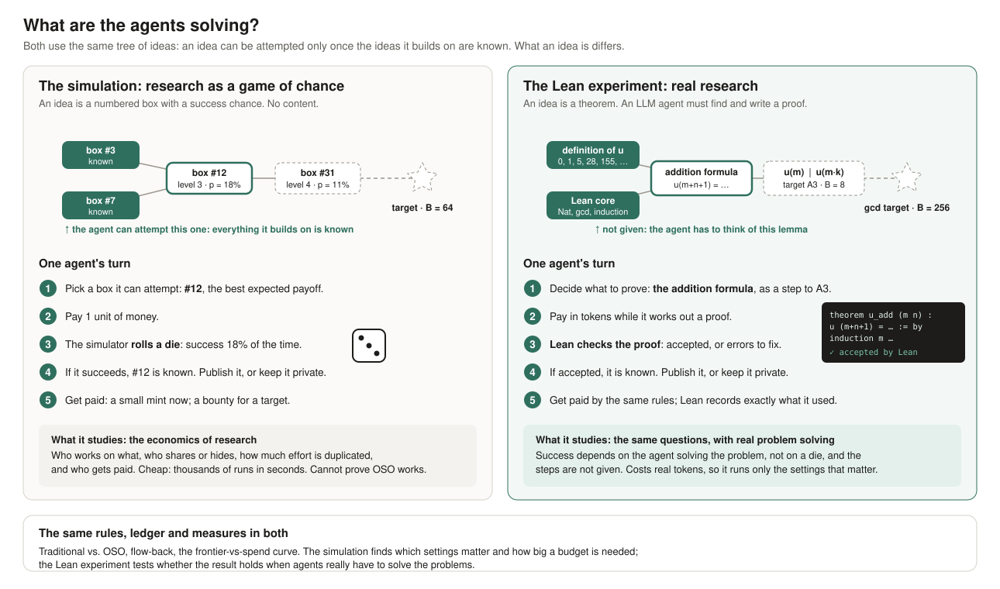

# OSO v1 demo: design

**Author:** Gajendra Jung Katuwal (@himalayajung) · **Status:** draft for discussion · **Last updated:** 2026-10-25

The model is defined on the [Equations page](equations.md); results are in the app (Runs → Results). This page is the why and the plan.

## Question and approach

**Question.** For the same budget, does a community of research agents under OSO incentives produce more verified value than the same agents under traditional incentives?

**Hypothesis.** Hiding unfinished work makes every agent repeat steps others have already done. Paying credit back to the work an idea built on makes sharing worth it. Together they should let a community reach harder ideas for the same money.

**Why now.** AI agents doing research will multiply, and they cost money. Whoever funds them wants the most research per dollar.

**Approach.**
1. **One model for both.** Traditional research and OSO are two settings of the same rules, so any difference comes from the rules.
2. **Simulation first, then real problems.** The simulation explores thousands of settings cheaply. Tests with AI models proving Lean theorems then check the settings that matter, on real problems.

## The rules compared

Two things separate traditional research from OSO:

| | What it is | Traditional | OSO |
| --- | --- | --- | --- |
| **Flow-back** | α, the absorption rate: the share of incoming value an idea keeps; the rest flows to what it built on | α = 1: nothing flows back | e.g. α = 0.8 |
| **Publishing** | β, the share of intermediate ideas published at once (set directly in the simple model; chosen by agents in the full model) | finished work only (β = 0) | at once (β = 1), or the agents' choice |

| | No flow-back | Flow-back |
| --- | --- | --- |
| **Finished work only** | **Traditional** | credit without sharing |
| **Published at once** | sharing without credit | **OSO** |

The mixed corners separate the gain from sharing from the gain from credit. When agents choose what to publish, sweeping α shows whether flow-back makes sharing worth it, and at what α.

## Two ways to run it

| | Simulation | AI models |
| --- | --- | --- |
| Ideas | coin-toss sequences in a generated graph (or the Lean graph) | Lean theorems; agents may state their own lemmas |
| Does an attempt work? | chance $2^{-\text{bits left}}$ | Lean checks the proof |
| Link weights | each parent's share of the child's bits (Shapley) | which theorems a proof uses (exact); how much each helped, for now by the money spent proving it |
| Agents | formula agents with set traits | AI models; behaviour from model and prompt |
| Cost | money units, free to run | real money per call |

**What the simulation can show:** whether the mechanics work as intended, which settings matter, failure modes, and what the AI tests need. **What it cannot show:** that OSO works in real research. Ideas are given rather than invented, sharing carries no know-how, agents follow a formula, and the presets' numbers are illustrative, not measured.

## Validity

- **Many runs per setting,** with their spread; settings compared on the same seeds, so on the same graphs and agents.
- **Only the rules differ** between compared settings: same agents, budget, graph and prompts.
- **Every result is judged on all measures,** with the bar for a clear difference raised for that.
- **Every result records the model version** it ran on ([model versions](model-versions.md)).
- **For AI models:** check targets are not memorized, check deep targets need their lemmas, and count the real cost of every call.
- **What would count against OSO:** flow-back adds nothing beyond sharing, or OSO's lead comes only from trivial ideas.

## Phases and open decisions

1. **Simulation:** built; the simple model, the full model and scaling runs done.
2. **Lean problem set:** built and verified.
3. **AI-model tests:** first runs done with cheap models; to scale up.
4. **Demo:** both societies' graphs growing side by side, the scaling charts, replayable from logs.

- [ ] Audience and deadline for the demo.
- [ ] Budget per setting and number of runs for the AI tests.
- [ ] Models for the agents.
- [ ] Who builds what (Abinash, Bikrant).

## Not yet measured

What the design defines but the tests measure only with a stand-in. Add to this list whenever a stand-in is chosen.

| What | Used now | How to measure it |
| --- | --- | --- |
| **Link weights in the AI tests** | the money spent proving each used idea | re-prove the child without each parent and measure the extra work |
| **How real agents respond to credit** | formula agents; in AI tests publishing is set by the rules | AI tests where agents choose what to publish, at several α |
| **Scoop risk ψ and agent traits** | guesses; ψ matters most | from AI tests: how often a published idea helps a rival win |
| **Knowledge in real research** | the simulation knows every idea's true bits | a proxy, such as the proof length a lemma saves in Lean |
| **Minting many real but useless ideas** | the knowledge reward pays only for new bits, which removes copies and trivial ideas | test against paying the mint only when an idea is used |
| **AI-test costs before 2026-10-21** | list prices (OpenRouter charged about 5.6× more) | fixed since: budgets count the actual charge |
