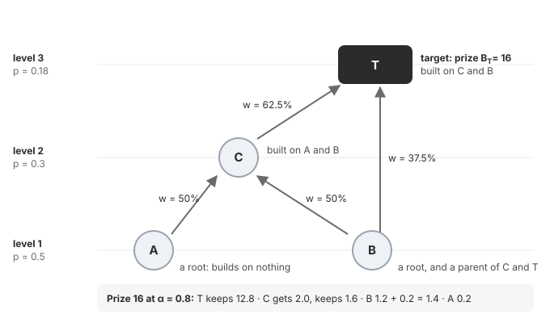

<!-- math -->
# Equations

Every rule of the experiment as a formula, in the order a run uses them. Each formula has one line saying what it does, and is worked out on the small tree below. The simulation uses all of them; the AI-model tests use the same rules, except where [section 10](#10-ai-model-tests-what-changes) says otherwise. The same ideas in words: [How it works](README.md). Full definitions: [the design](design.md).

## The example tree

- **Results** are the nodes. A **parent** is a result another one builds on: A and B are C's parents; C and B are T's.
- **Arrows** go from a parent to the result built on it. The number on an arrow is the **link weight** (section 5).
- **Roots** (A, B) build on nothing. **Targets** (T) carry a prize.
- A result **above** $x$ is built on $x$, directly or through others: T is above C, and C and T are above A.

## Symbols

Grouped by what they belong to, in the order of the sections below. One letter per role, used the same way everywhere. A hat marks an agent's own estimate: $\hat B$ is the prize as agent $i$ sees it.

**The tree** ([section 1](#1-the-tree))

| Symbol | Meaning | In the example | Default |
| --- | --- | --- | --- |
| $x$ | a result | A, B, C or T | |
| $y \to x$ | $y$ is a parent of $x$ ($x$ builds on $y$) | $C \to T$ | |
| $t$ | a target | T | |
| $\ell_x$ | level of $x$ | $\ell_C = 2$ | |
| $p_x$ | chance one try at $x$ works | $p_C = 0.3$ | $0.5 \times 0.6^{\ell - 1}$ |
| $B_t$ | prize of target $t$ | $B_T = 16$ | $4 \times 2^{\ell - 1}$ |

**A try** ([section 2](#2-a-try))

| Symbol | Meaning | Default |
| --- | --- | --- |
| $i$ | an agent | 12 agents |
| $s_i$ | skill | 1 (explorer 0.5) |
| $\pi_{i,x}$ | chance agent $i$'s try at $x$ works | |

**Money** ([section 3](#3-money-each-round))

| Symbol | Meaning | Default |
| --- | --- | --- |
| $X,\ R$ | total money, number of rounds | 1200, 120 |
| $k_i$ | cost of one try | 1 (explorer 0.3) |
| $\rho$ | how far money follows past earnings | 0.5 |
| $b_i,\ \bar E_i$ | agent $i$'s money this round, its recent earnings | |

**The mint** ([section 4](#4-the-mint))

| Symbol | Meaning | Default |
| --- | --- | --- |
| $m$ | mint: tokens for each new result | 1 |
| $c$ | share of each new mint passed to the parents | traditional 0, OSO 0.15 |
| $\theta$ | chance a trivial result is rejected | 0.5 |
| $g_i$ | gaming: share of tries spent on trivial results, for their mint | 0 (gamer 0.6) |

**Value flow** ([section 5](#5-value-flow))

| Symbol | Meaning | In the example | Default |
| --- | --- | --- | --- |
| $w_{y \to x}$ | link weight: how much $x$ owes parent $y$ | $w_{C \to T} = 62.5\%$ | from difficulty |
| $\alpha$ | share of incoming value a result's author keeps | T keeps 12.8 of 16 | traditional 1, OSO 0.8 |
| $\text{share}(x, z)$ | part of value entering $x$ that reaches $z$'s author | $\text{share}(T, C) = 0.1$ | |
| $S_x$ | what authoring $x$ earns from later work | $S_C = 1.675$ | |

**Choosing what to try** ([section 6](#6-choosing-what-to-try))

| Symbol | Meaning | Default |
| --- | --- | --- |
| $\text{win}_x$ | chance of being first at $x$ | |
| $h_x$ | rounds until value from above arrives | |
| $\delta_i$ | patience: how much later payoffs count | 0.85 to 0.98 |
| $q_i,\ \sigma_0$ | judgement, and how wrong a poor judge's estimates are | 0.3 to 1; 1 |
| $\gamma_i$ | risk attitude: above 0 cautious, below 0 chases long shots | −0.2 to 0.2 |
| $V_{i,x},\ U_{i,x}$ | what $x$ is worth to $i$, and its score | |
| $\tau,\ \varepsilon$ | choice randomness, chance of a random pick | 0.3, 0.05 |

**Choosing whether to share** ([section 7](#7-choosing-whether-to-share))

| Symbol | Meaning | Default |
| --- | --- | --- |
| $\beta_i$ | liking for sharing | −1 to 0.5 |
| $\psi$ | scoop risk: how much publishing helps a rival win | 0.5 |
| $\kappa$ | how much publishing raises a result's use | 1 |

**Sharing and its costs** ([section 8](#8-sharing-and-its-costs))

| Symbol | Meaning | Default |
| --- | --- | --- |
| $\omega_i$ | reuse: chance a round of taking up a published result | 0.6 to 1 |
| $a$ | cost to take up a result (optional) | 0 |
| $e$ | chance a proof is wrong (optional) | 0 |

**Measures** ([section 9](#9-measures))

| Symbol | Meaning |
| --- | --- |
| $L^*$ | the main level a run is judged on |
| $\text{value},\ \text{ROI}$ | prizes of the targets solved, and value per unit of money |
| $SE$ | standard error of a row's average |

## 1. The tree

How hard a result is: each level up, a try works less often.

$$p_x = p_0 \, \eta^{\,\ell_x - 1} \qquad (p_0 = 0.5,\ \eta = 0.6)$$

How big a prize is: it doubles with each level.

$$B_t = B_0 \cdot 2^{\,\ell_t - 1} \qquad (B_0 = 4)$$

*Example:* A and B (level 1) have $p = 0.5$, C has $p = 0.3$, T has $p = 0.18$. T's prize is $B_T = 4 \cdot 2^2 = 16$. A hand-drawn tree can set $p_x$ and $B_t$ for each result instead.

## 2. A try

The chance that agent $i$'s try at $x$ works:

$$\pi_{i,x} = \min(1,\ s_i \, p_x)$$

A specialist's skill is $\times 1.6$ in its own area and $\times 0.4$ elsewhere. A try costs $k_i$. A success on a result someone else already published is a **duplicate** and earns nothing.

*Example:* a cheap explorer ($s = 0.5$) trying T: $\pi = 0.5 \times 0.18 = 0.09$, about one success in eleven tries.

**Learning from failure** (optional). Each failed try makes the next one likelier. $F_{i,x}$ counts $i$'s own failures on $x$, and $F^{\text{pub}}_x$ the failures others made public:

$$\pi_{i,x} = \min\!\Big(\text{cap},\ s_i \, p_x \big(1 + \text{gain}\,(F_{i,x} + w_{\text{shared}} \, F^{\text{pub}}_{x})\big)\Big)$$

## 3. Money each round

Each round releases $X/R$. Agent $i$ gets part of it equally (out of $N$ agents) and part by its recent earnings $\bar E_i$:

$$b_i = \frac{X}{R}\left[\frac{1-\rho}{N} + \rho\,\frac{\bar E_i}{\sum_{i'} \bar E_{i'}}\right] \qquad \bar E_i \leftarrow 0.7\,\bar E_i + 0.3 \times \text{this round's earnings}$$

It makes $\lfloor b_i / k_i \rfloor$ tries and keeps the rest for the next round. The run stops when the money is spent or every target is solved.

*Example:* with the defaults, each round releases $1200/120 = 10$. An agent earning nothing still gets $10 \times 0.5/12 \approx 0.42$; one earning half of everything gets $0.42 + 10 \times 0.5 \times 0.5 \approx 2.9$.

## 4. The mint

**The mint.** A new result pays its author $(1-c)\,m$, and $c\,m$ enters its parents by link weight and flows down from there (section 5). A root keeps all of $m$. A trivial result is rejected with chance $\theta$; if accepted it earns $m$.

*Example* ($c = 0.15$): when C is published, C gets 0.85, and A and B get 0.075 each.

**Gaming.** With chance $g_i$ an agent spends a try on a trivial result instead, to collect its mint (section 6).

## 5. Value flow

**Link weight** is the work the parent saves: finding parent $y$ again would take about $1/p_y$ tries. A result's weights add up to 1.

$$w_{y \to x} = \frac{1/p_y}{\sum_{y' \to x} 1/p_{y'}}$$

*Example:* T's parents are C ($1/p = 3.33$) and B ($1/p = 2$), so $w_{C \to T} = 3.33/5.33 = 62.5\%$ and $w_{B \to T} = 37.5\%$. C's parents A and B are equally hard: 50% each.

**The waterfall.** Value entering result $x$ is split: $x$'s author keeps $\alpha$, and $1-\alpha$ flows to its parents by link weight, where the same split repeats. $\text{share}(x, z)$ is the part of value entering $x$ that reaches the author of $z$ ($z$ is $x$ itself or a result below it):

$$\text{share}(x, x) = \alpha \quad (1 \text{ for a root}) \qquad \text{share}(x, z) = \sum_{y \to x} (1-\alpha)\, w_{y \to x}\, \text{share}(y, z)$$

**The prize.** When target $t$ is first published, $B_t$ enters $t$ through the waterfall.

*Example* ($\alpha = 0.8$): T's prize of 16. T keeps $0.8 \times 16 = 12.8$. The other 3.2 goes 62.5% to C (2.0) and 37.5% to B (1.2). C keeps $0.8 \times 2.0 = 1.6$ and passes 0.2 each to A and B. In all: **T 12.8, C 1.6, B 1.4, A 0.2.** Under traditional rules ($\alpha = 1$) T keeps all 16.

## 6. Choosing what to try

Each round, an agent looks at its **frontier**: results it does not know yet whose parents it all knows. It scores each one.

**Chance of being first** at $x$, when $n_x$ agents could try it now:

$$\text{win}_x = \frac{1}{\max(1,\ n_x)}$$

**Rounds until value from above arrives:** 5 per level between $x$ and the targets above it (1 if there are none).

$$h_x = \max\!\big(1,\ 5\,(\text{average level of targets above } x - \ell_x)\big)$$

**What authoring $x$ earns from later work** (flow-back), if every target above it is solved and every result above it published. The first sum is prizes flowing down; the second is mints flowing down:

$$S_x = \sum_{t \text{ above } x} B_t \, \text{share}(t, x) \;+\; \sum_{z \text{ above } x} c\, m \sum_{y \to z} w_{y \to z}\, \text{share}(y, x)$$

*Example:* for C, T's prize sends $16 \times 0.2 \times 0.625 \times 0.8 = 1.6$, and T's mint sends $0.15 \times 0.625 \times 0.8 = 0.075$, so $S_C = 1.675$. Under traditional rules $S_x = 0$ for every result.

**What $x$ is worth to agent $i$.** $\hat B_x$ is the largest prize above $x$, and $\hat S_x$ is $S_x$, each as $i$ sees it: the true value times $(1 + \sigma_0 (1 - q_i)\, \xi)$, with $\xi$ a random normal number drawn once.

$$V_{i,x} = \underbrace{(1-c)\,m}_{\text{mint}} + \underbrace{\alpha\, B_x\, \text{win}_x}_{\text{prize, if } x \text{ is a target}} + \underbrace{\delta_i^{h_x}\, \alpha\, \hat B_x\, \text{win}_x}_{\text{stepping stone}} + \underbrace{\delta_i^{h_x}\, \hat S_x}_{\text{flow-back}}$$

**The score** weighs value by the chance of success, with a penalty for uncertain tries:

$$U_{i,x} = V_{i,x}\left(\pi_{i,x} - \gamma_i \sqrt{\pi_{i,x}(1-\pi_{i,x})}\right)$$

*Example:* a patient agent ($\delta = 0.98$) looking at C: $h_C = 5\,(3 - 2) = 5$, so later value counts $0.98^5 = 0.90$. An impatient racer ($\delta = 0.85$) counts it $0.85^5 = 0.44$, so foundations look half as good to it.

**The pick.** With chance $g_i$ the agent farms a trivial result instead. Otherwise it picks at random with chance $\varepsilon$, and else by softmax: the better the score, the likelier the pick ($U^{\max}_i$ is its best score).

$$P(x) = \frac{\exp\!\big((U_{i,x} - U^{\max}_i)/(\tau\, |U^{\max}_i|)\big)}{\sum_{x' \text{ in the frontier}} \exp\!\big((U_{i,x'} - U^{\max}_i)/(\tau\, |U^{\max}_i|)\big)}$$

## 7. Choosing whether to share

Only in the settings where agents choose; targets are always published. Agent $i$ publishes result $x$ at once if what sharing brings is at least the risk it adds:

$$\underbrace{\beta_i\, m}_{\text{liking for sharing}} + \underbrace{M_x\big(1 - \delta_i^{h_x}\, \text{win}_x\big)}_{\text{mint lost by waiting}} + \underbrace{\delta_i^{h_x}\, \hat S_x\, \kappa}_{\text{credit when others use it}} \;\ge\; \underbrace{\alpha\, \hat B_x\, \text{win}_x\, \psi}_{\text{scoop risk}}$$

$M_x$ is $x$'s mint: $(1-c)\,m$, or $m$ for a root. A private result earns its mint only if its author later wins a target above it, which is why waiting can lose it.

*Example:* an agent holding C under OSO, with 3 agents able to try C ($\text{win} = 1/3$), $\delta = 0.9$ ($0.9^5 = 0.59$), no liking for sharing, and true estimates. Sharing brings $0.85 \times (1 - 0.59/3) + 0.59 \times 1.675 \approx 1.67$. The scoop risk is $0.8 \times 16 \times \tfrac13 \times 0.5 \approx 2.13$. It keeps C private. At $\alpha = 0.3$ the risk falls to 0.8 and $S_C$ rises, so it shares.

## 8. Sharing and its costs

**Uptake.** Each round, agent $i$ takes up each published result it does not know with chance $\omega_i$, and can then build on it.

**Costly knowledge** (optional). Taking up a result costs $a$ from the round's money, while the agent can afford it.

**Wrong results** (optional). A successful proof is wrong with chance $e$, and anything built on a wrong result is wrong too. Targets are checked: a target resting on a wrong result is rejected, and the wrong results under it are withdrawn.

## 9. Measures

**Frontier:** the hardest level published by the end of the run.

$$\text{frontier} = \max\{\ell_x : x \text{ published}\}$$

**Reach and cost:** the share of runs that published the main level $L^*$, and the money spent by the round they did.

**Value gained and return on the money (ROI):**

$$\text{value} = \sum_{t \text{ solved}} B_t \qquad \text{ROI} = \frac{\text{value}}{\text{money spent}}$$

*Example:* solving T for 40 units of money gives value 16 and ROI 0.4.

**Sharing:** the share of proved results (other than targets) published in the round they were proved. **Waste:** the share of money spent on duplicates, dead ends and trivial results.

**Credit accuracy:** how well prize pay matches true contribution. Contribution splits each solved prize over the results in its proof by $1/p$:

$$\text{credit} = 1 - \tfrac12 \sum_i \left| \frac{\text{pay}_i}{\sum \text{pay}} - \frac{\text{contribution}_i}{\sum \text{contribution}} \right|$$

**The answer.** Rows are compared on the measure fixed before the run. Two rows differ clearly when the gap between their averages is more than two standard errors:

$$|\bar v_A - \bar v_B| > 2\sqrt{SE_A^2 + SE_B^2} \qquad SE = \frac{\text{standard deviation}}{\sqrt{\text{number of runs}}}$$

## 10. AI-model tests: what changes

Sections 3 to 5 stay; the rest changes like this:

- **A try** works when Lean accepts the proof. $p_x$ is not set but measured.
- **Prizes:** $B_t = 4 \cdot 2^{\,d_t - 1}$, where $d_t$ is the target's depth in the reference tree.
- **Money** is dollars, as charged by the model provider, and each lab gets the same budget.
- **Link weight** uses the money spent to prove each parent, $\text{spent}_y$, as the stand-in for the work it saves:

$$w_{y \to x} = \frac{\text{spent}_y}{\sum_{y' \to x} \text{spent}_{y'}}$$

- **Choices** (what to try, whether to pass) are the models' own, not the formulas of sections 6 and 7. Sharing is set by the rules: traditional publishes when a target is solved, OSO at once.
- **ROI** is prize value per dollar.

What is still a stand-in or a guess: [the design, section 12](design.md#12-not-yet-measured).
