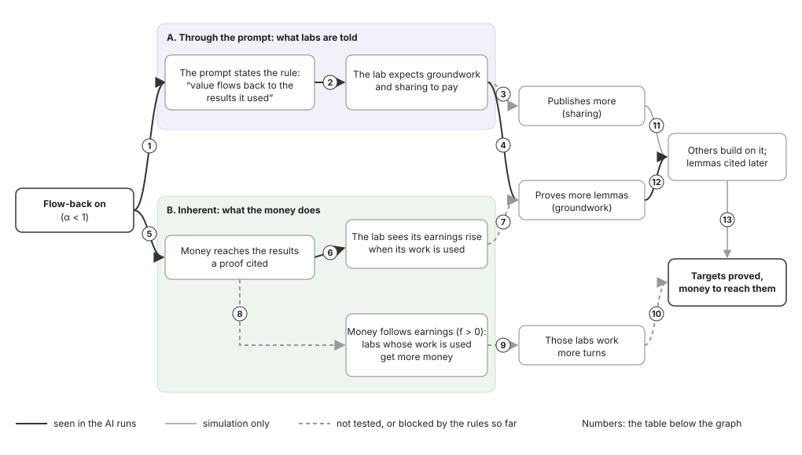

# Flow-back: what it does so far

2026-11-09. Flow-back is OSO's α: a result's author keeps α of what it earns, and the rest flows back to the results its proof used. α 1 means nothing flows back. Setups are named by their [OSO parameters](lean-experiment.md#the-setups). **Finding** = measure fixed in advance; **lead** = noticed afterwards or small run.

## Summary

| Question | Answer | Strength |
| --- | --- | --- |
| Does it make labs do more groundwork? | Yes, in every experiment where only flow-back paid for lemmas | Finding in two experiments, lead in the rest |
| Why? | Labs reason that a lemma earns when others use it; without flow-back, that it helps rivals | Lead (labs' thinking) |
| Does the size of α matter? | Little: α 0.8 and α 0.2 look alike | Lead |
| More targets or lower cost? | No, in any experiment | Finding |
| Does it make labs share? | Yes, once publishing earns nothing by itself: 63% published at α 1, 90% at α 0.2 | Lead (8 lemmas at α 1) |
| Does it send money to useful labs? | Not tested yet (f = 0 in every run) | – |
| Through the prompt or through the money? | Not separated yet; three leads point to the prompt (section 2) | Lead |

## 1. Two routes: the prompt and the money

| # | Arrow | Route | Evidence so far |
| --- | --- | --- | --- |
| 1 | Flow-back → the prompt states the rule | A | By design. The shared library's prompt says the opposite: "Nothing flows back" |
| 2 | Rule → lab expects groundwork to pay | A | **Seen:** 18 of 20 OSO sentences say a lemma earns when used; 0 of 20 in the shared library |
| 3 | Expects pay → publishes more | A | **Seen** once publishing is not paid (Labs choose, reward off: 63% → 79% → 90% as α falls); blocked in every other run. Like arrow 4, it can also come through arrow 7 |
| 4 | Expects pay → more lemmas | A | **Seen,** but mixed with arrow 7: more lemmas in 4 of 5 experiments |
| 5 | Flow-back → money reaches cited results | B | By design |
| 6 | → lab sees its earnings rise | B | By design: each turn shows "Your earnings so far" |
| 7 | Earnings seen → more lemmas | B | **Not tested:** cannot be told apart from arrow 4 |
| 8 | → money follows earnings | B | **Not tested:** f = 0 in every run |
| 9, 10 | More money → more turns → targets | B | **Not tested** |
| 11 | Sharing → others build on it | | Simulation only |
| 12 | More lemmas → cited later | | **Seen:** +4.1 cited a run (Spend all), +5.1 (Fair-prompt check) |
| 13 | Building on others → targets, cost | | Simulation yes; AI runs: no clear gain |

**Leads that route A carries the effect:**

| Lead | Why it points to the prompt |
| --- | --- |
| α 0.8 and α 0.2 look alike (section 5) | The money flowing back differs 4×; the prompt differs only in one number |
| Labs quote the rule on 67–87% of OSO lemma turns | They reason from what they are told |
| They mention their own earnings (23–57%) only as a running total | In 16 examples read, none linked earnings to others using their work |
| The shared library's prompt says "Nothing flows back" | Route A may also push its groundwork down, so the gap overstates route B |

**The test that separates them** (about $25 at $0.15 a lab, 10 runs a setup):

| | Money flows back (α 0.2) | Money does not (α 1) |
| --- | --- | --- |
| **Prompt states flow-back** | OSO α 0.2 (run) | Told, not paid |
| **Prompt is silent** | Paid, not told (labs see only their earnings) | Neutral shared library |

Route A = the difference between the rows; route B = between the columns. "Told, not paid" gives labs a rule that is not applied, so the write-up must say so.

## 2. What flow-back should do

| Effect | Simulation | AI runs on Lean |
| --- | --- | --- |
| Labs share | **Finding:** 24% of ideas shared at α 1, 66% at α 0.2 | **Lead: yes, once publishing is not paid** (63% at α 1, 90% at α 0.2). With publishing paid, 98–100% at every α |
| Labs do groundwork | Yes | **Yes** (section 3) |
| Money goes to labs whose work is used | **Lead:** with money following earnings, best α drops to 0.2 | Not tested |

### β by α: sharing when agents choose

β is the share of ideas published as soon as they are proved. From saved results (`node scripts/beta-by-alpha.ts`):

| α | AI labs, paid to publish | AI labs, not paid | Sim. matched, paid | Sim. matched, not paid | Sim. full model |
| --- | --- | --- | --- | --- |
| 1 | 98% (96–99%) of 197 | **63% (31–86%) of 8** | 17% (16–18%) | 16% (15–17%) | 33% (31–35%) |
| 0.8 | 99% (96–100%) of 199 | **79% (60–90%) of 28** | 20% (19–21%) | 16% (15–17%) | 36% (34–38%) |
| 0.2 | 100% (97–100%) of 210 | **90% (74–97%) of 30** | 93% (93–94%) | 93% (92–93%) | 66% (64–67%) |
| 0 | – | – | – | – | 100% |

| Series | What it is |
| --- | --- |
| AI labs, paid to publish | Labs choose: 4 DeepSeek labs, 10 runs per α; a new result earns up to 4 when published. All lemmas pooled |
| AI labs, not paid | Labs choose, knowledge reward off (Nov 9): the same with nothing paid for publishing |
| Sim. matched, paid | The simulation set up like Labs choose (Lean tree, 4 agents, same reward); 100 runs per α |
| Sim. matched, not paid | The same with no reward for publishing: the prediction for "AI labs, not paid" |
| Sim. full model | The README's full model (step 5): default idea graph, 12 agents; 100 runs per α |

- **In the simulation, β rises as α falls:** from 16–33% at α 1 to 66–93% at α 0.2. Little change from α 1 to 0.8; the rise comes at low α.
- **AI labs paid to publish did not follow it:** 98–100% at every α. The simulation with the same pay still predicted 17% at α 1.
- **AI labs not paid did follow it, in direction:** 63% at α 1, 79% at α 0.8, 90% at α 0.2. At α 0.2 this matches the prediction (93%); at α 1 and 0.8 the labs shared far more than predicted (16%). Lead, not a finding: at α 1 they proved only 8 lemmas in 10 runs.
- **Turning the reward off cut lemma work sharply:** lemma attempts fell from 366 to 17 at α 1 and from 401 to 45 at α 0.2. Labs went for targets instead.
- AI labs: lemmas pooled over runs, with Wilson 95% ranges; simulation: means with 95% ranges. Only α 1, 0.8, 0.2 (and 0) were run, so the lines between points are not data.

## 3. Groundwork: lemmas proved per run

| Experiment (runs a setup) | Traditional | Shared library (α 1) | OSO α 0.8 | OSO α 0.2 | α 0.2 minus shared (95% range) |
| --- | --- | --- | --- | --- | --- |
| Spend all (20) | 7.2 | 7.2 | 10.7 | 13.8 | cited later: +4.1 (+1.6 to +6.5) |
| Fair-prompt check (10) | – | 8.5 | – | 17.2 | +8.7 (+3.4 to +14.0) |
| May quit (10) | 1.0 | 0.3 | 3.7 | 2.5 | +2.2 (+1.4 to +3.0) |
| Labs choose, publishing paid (10) | – | 19.6 | 19.6 | 20.4 | +0.8 |
| Labs choose, nothing paid (10) | – | 0.7 (α 1) | 2.7 | 3.0 | +2.3 (+0.8 to +3.8); cited +1.1 (+0.2 to +2.0) |
| Harder targets (5) | 20.0 | 21.8 | – | 26.4 | +4.6 (+0.2 to +9.0) |
| Harder targets, pay per lemma (α 1, m 1) | | | | 63.0 | +41.2 (+5.5 to +76.9) against shared |

- With flow-back, labs also built on each other more: Spend all 2.2 → 5.8 a run, Fair-prompt check 3.1 → 7.0.
- No gain in Labs choose, where a lemma was paid on publishing at every α.
- A certain payment per lemma did far more than flow-back.

## 4. Why: what the labs say

Share of turns where the lab's thinking weighs what a result gets when another lab uses it (`scripts/lean-flowback.py`, 118 runs):

| Experiment | Setup | Lemma turns | Target turns |
| --- | --- | --- | --- |
| Fair-prompt check | OSO α 0.2 | 69% of 160 | 39% of 214 |
| | Shared library | 33% of 107 | 19% of 225 |
| May quit | OSO α 0.8 | 72% of 58 | 39% of 244 |
| | OSO α 0.2 | 74% of 46 | 47% of 195 |
| | Shared library / traditional | 0% of 6 / 0% of 13 | 12% / 3% |
| Labs choose | α 1 / 0.8 / 0.2 | 28% / 60% / 66% | 13% / 26% / 31% |
| Harder targets | OSO α 0.2 | 66% of 253 | 32% of 301 |
| | Shared library | 31% of 230 | 13% of 406 |
| | Pay per lemma / traditional | 13% / 11% | 7% / 2% |

Which way they reason, from 20 sentences per setup read by hand:

| Setup | "Earns when others use it" | "Earns nothing, or helps a rival" | Unclear |
| --- | --- | --- | --- |
| OSO α 0.2 | 18 | 1 | 1 |
| Shared library | 0 | 16 | 4 |

| Setup | Typical sentence |
| --- | --- |
| OSO α 0.2 | "If another lab proves A5 citing our lemma, A5 value flows 80% to used results, ours gets share." |
| Shared library | "If we prove `msort_sorted`, other labs may use it to solve B5/H5 and earn bounty, not us." |

- The payoff reason is real: labs work it out.
- About a third of OSO target turns also weigh flow-back, then go for the target anyway.

## 5. The size of α

Same wording; only the number differs.

| Measure | OSO α 0.8 | OSO α 0.2 |
| --- | --- | --- |
| Lemma turns weighing flow-back: May quit | 72% | 74% |
| Same: Labs choose | 60% | 66% |
| Lemmas a run: Spend all | 10.7 | 13.8 |
| Same: May quit | 3.7 | 2.5 |
| Same: Labs choose | 19.6 | 20.4 |

**Lead:** labs respond to *whether* value flows back, much less to *how much*. The rule's wording may carry part of the effect.

## 6. What it has not done

| Measure | OSO α 0.2 against shared library |
| --- | --- |
| Targets, Spend all | +0.4 (−0.1 to +0.9) |
| Targets, May quit | +0.0 (−0.8 to +0.8) |
| Targets, Fair-prompt check | +0.5 (−0.4 to +1.4) |
| Money to 7 of 11 targets, harder targets (median) | $0.727 against $0.509 (no range, 5 runs) |
| Earlier leads (cheapest to 5 targets; B5 11 of 20 vs 0 of 20) | Did not hold in later runs |

About half of all lemmas are never cited, so extra groundwork helps only where a target lacks it.

## 7. Tests still to run

| Test | What it would show | Cost |
| --- | --- | --- |
| Money follows earnings (f > 0) | Whether money moves to labs whose work is used | to plan |
| Prompt × money, 2 × 2 (section 1) | Route A against route B | about $25 |
| Same wording at α 0.9, 0.5, 0.2 | Whether the amount matters | to plan |

## Method

- Lemma counts and ranges: `scripts/lean-estimates.py`; per experiment: [results](ai-agent-results.md).
- Thinking: `scripts/lean-flowback.py`, a keyword count over sentences; direction from 40 sentences read by hand (`--sample`).
- Thinking was saved only from the Fair-prompt check on, so Spend all has none.
