# An abstract research field: OSO vs. traditional research

> A generic field of 80 results in 8 levels and 3 areas, with 7 prizes; the simulator's default world.

**For the same money, the OSO community got further, or got there more cheaply, than the traditional one.**

- **How far:** with a budget of 1200 compute, OSO reached level **7.9** of 8 on average; traditional research reached **5.7**.
- **Targets solved:** OSO solved **6.9** of 7; traditional solved **4.2**.
- **Cost to reach level 7:** OSO 485 compute; traditional 957 compute (in the 35% of runs that got there).
- **Does flow-back make agents share?** When agents choose, sharing rises clearly (by 0.2 or more) once α is 0.3 or lower. At OSO's default α = 0.8, agents shared 22% of their intermediate results.
- **Robustness:** OSO's lead in level is smallest when shared knowledge is **costly to absorb** (+2.0 levels).
- **Sensitivity:** Across the tested values of the parameters a market or community sets, OSO's lead (agents choosing what to share) runs from **+0.3** to **+1.9** levels. The smallest lead, at ρ, compute follows earnings = 100%, is still clearly positive. The lead is most sensitive to **α, retention**.

*The verdict compares the hardest level reached, the targets solved and (when both communities reach level 7 in at least 90% of runs) the cost to get there, each against two standard errors. 100 simulated runs per setting · simulator commit `44f5044+` · 2026-10-19. This is a simulation with guessed parameters, not evidence about real research; see [What this shows](#what-this-shows-and-what-it-does-not).*

## 1. The problem space

A research field with no particular subject. Results build on results in eight levels of rising difficulty, across three loosely connected areas. Seven targets carry prizes that double with each level, and about a third of all results are dead ends that lead to no target. Twelve agents of six kinds work in it: patient foundation builders, target racers, cheap explorers, specialists, a free rider and a gamer who farms trivial results.

| In this space | means |
| --- | --- |
| a result | a finding that later findings can build on |
| a target | a prize-carrying finding announced in advance |
| an attempt | one try at proving a finding, which succeeds or fails |
| an area | a subfield |


The tree has 80 results in 8 levels and 3 areas (area 1, area 2, area 3). 29 are dead ends: no target depends on them. 7 are targets:

| target | level | bounty | results it rests on |
| --- | --- | --- | --- |
| T1 | 3 | 16 | 8 |
| T2 | 3 | 16 | 7 |
| T3 | 5 | 64 | 21 |
| T4 | 5 | 64 | 18 |
| T5 | 7 | 256 | 38 |
| T6 | 7 | 256 | 23 |
| T7 | 8 | 512 | 46 |

How hard each level is, before an agent's skill:

| level | results | targets | success chance per attempt |
| --- | --- | --- | --- |
| 1 | 10 | 0 | 50% |
| 2 | 10 | 0 | 30% |
| 3 | 10 | 2 | 18% |
| 4 | 10 | 0 | 11% |
| 5 | 10 | 2 | 6% |
| 6 | 10 | 0 | 4% |
| 7 | 10 | 2 | 2% |
| 8 | 10 | 1 | 1% |

The community has 12 agents (3 foundation, 3 racer, 2 explorer, 2 specialist, 1 freeRider, 1 gamer) and a budget of 1200 compute over 120 rounds.

## 2. Progress for the money


Each line is the mean, over 100 runs, of the hardest level the community had published after spending that much compute. A line that ends early means every target was solved and the funder stopped paying.

## 3. The six settings

The rules are the only difference between rows ([specification, section 3](https://github.com/open-science-org/OSO/blob/master/docs/demo-model.md#3-the-rules)). Traditional: nothing flows back to what a result built on, and work is published only when finished. OSO: value flows back (α = 0.8, c = 0.15), and results are published at once or when the agent chooses.

| setting | frontier | reach L7 | speed | cost | spend | targets solved | waste | credit | sharing |
| --- | --- | --- | --- | --- | --- | --- | --- | --- | --- |
| Traditional | 5.7 ± 1.2 | 0.35 | 96 ± 16 | 957 ± 161 | 1194 ± 11 | 4.2 ± 0.9 | 0.64 ± 0.09 | 0.95 ± 0.09 | 0.01 ± 0.01 |
| OSO (immediate) | 7.9 ± 0.2 | 1.00 | 49 ± 14 | 485 ± 141 | 849 ± 207 | 6.9 ± 0.5 | 0.86 ± 0.03 | 0.57 ± 0.07 | 1.00 ± 0.00 |
| Flow-back, finished-only | 5.5 ± 1.1 | 0.28 | 96 ± 18 | 959 ± 182 | 1195 ± 2 | 4.1 ± 0.9 | 0.64 ± 0.09 | 0.96 ± 0.07 | 0.00 ± 0.01 |
| No flow-back, immediate | 7.9 ± 0.3 | 1.00 | 50 ± 14 | 494 ± 143 | 871 ± 210 | 6.9 ± 0.4 | 0.84 ± 0.04 | 0.47 ± 0.09 | 1.00 ± 0.00 |
| No flow-back, choice | 6.0 ± 0.9 | 0.35 | 100 ± 16 | 990 ± 159 | 1195 ± 2 | 4.1 ± 0.9 | 0.66 ± 0.07 | 0.88 ± 0.12 | 0.23 ± 0.08 |
| OSO (choice) | 6.3 ± 1.0 | 0.43 | 96 ± 19 | 959 ± 186 | 1193 ± 11 | 4.4 ± 1.0 | 0.68 ± 0.09 | 0.87 ± 0.11 | 0.22 ± 0.09 |

Values are mean ± standard deviation over runs. *frontier*: hardest level published; *reach L7*: share of runs reaching level 7; *speed*, *cost*: rounds and compute to reach it; *credit*: how closely bounty pay matches true contribution; *sharing*: share of intermediate results published as soon as they were proved.

## 4. Does flow-back make agents share?


| α | intermediate results shared | frontier | reach level 7 | targets solved |
| --- | --- | --- | --- | --- |
| 1 | 23% | 6.0 | 35% | 4.1 |
| 0.8 | 22% | 6.3 | 43% | 4.4 |
| 0.6 | 25% | 6.4 | 48% | 4.4 |
| 0.5 | 28% | 6.7 | 63% | 4.5 |
| 0.4 | 34% | 6.9 | 73% | 4.7 |
| 0.3 | 47% | 7.2 | 86% | 5.2 |
| 0.2 | 63% | 7.6 | 98% | 5.9 |
| 0.1 | 77% | 7.8 | 100% | 6.5 |

Sharing rises clearly once α is 0.3 or lower: this is the threshold α* in this space. The threshold depends on the scoop risk ψ = 0.5, which is a guess.

## 5. When sharing is costly or sometimes wrong

Absorbing a published result costs 0.5 compute; proofs are wrong 10% of the time, results built on a wrong result are wrong too, and targets reveal and retract them.

| shared knowledge | traditional frontier | OSO frontier | OSO lead | traditional targets | OSO targets |
| --- | --- | --- | --- | --- | --- |
| free and correct | 5.7 | 7.9 | +2.3 | 4.2 | 6.9 |
| costly to absorb | 5.7 | 7.7 | +2.0 | 4.2 | 6.2 |
| sometimes wrong | 4.9 | 7.4 | +2.5 | 3.3 | 5.4 |
| costly and sometimes wrong | 4.7 | 6.9 | +2.2 | 3.2 | 4.7 |

## 6. Sensitivity to the parameters

In OSO, α and c are set by each community ([OIP-14](https://github.com/open-science-org/OIPs/blob/master/OIPS/oip-14.md)), validators decide how strict the screen is, funders decide how far compute follows earnings, and the mint may become a community parameter ([OIP-8](https://github.com/open-science-org/OIPs/blob/master/OIPS/oip-8.md)). Their values will be set by competing communities, not by us, so the result must hold across them. The parameters below the line are our guesses about how agents think.

Each parameter is varied alone, from this space's settings, with agents choosing what to share (the realistic case: incentives matter only if sharing is a choice). The lead is OSO's hardest level reached minus traditional's under the same parameter value; α and c do not exist under traditional rules, so there it is compared with traditional's default.


Across the tested values of the parameters a market or community sets, OSO's lead (agents choosing what to share) runs from **+0.3** to **+1.9** levels. The smallest lead, at ρ, compute follows earnings = 100%, is still clearly positive. The lead is most sensitive to **α, retention**.

| parameter | means | tested | OSO lead (lowest to highest) |
| --- | --- | --- | --- |
| α, retention | share of the value reaching a result that it keeps; the rest flows back to what it built on | 0.2, 0.4, 0.6, 0.8, 0.95 | +0.4 to +1.9 |
| c, cited share of the mint | share of each new mint paid to the results it built on | 0%, 5%, 15%, 30%, 50% | +0.5 to +0.7 |
| mint per result | tokens minted for each validated result, relative to bounties (the smallest bounty is a few units) | 0, 0.5, 1, 2, 4 | +0.5 to +1.1 |
| θ, validation screen | chance validators reject a trivial result | 0%, 25%, 50%, 75%, 95% | +0.6 to +1.1 |
| ρ, compute follows earnings | share of each round's compute funders give by recent earnings rather than equally | 0%, 25%, 50%, 75%, 100% | +0.3 to +0.8 |
| ψ, scoop risk | how likely agents think a shared lemma lets a rival take the target | 0, 0.25, 0.5, 0.75, 0.9 | +0.6 to +2.3 |
| κ, value of being used | how much agents think publishing raises a lemma's use | 0, 0.5, 1, 2, 4 | +0.5 to +0.8 |
| σ₀, perception noise | how noisily agents see the value of what they might attempt | 0, 0.5, 1, 2 | +0.3 to +1.2 |
| τ, choice randomness | how loosely agents follow their best option | 0.05, 0.15, 0.3, 0.6, 1 | +0.4 to +1.6 |
| attribution error | noise in the ledger's weights of what each result built on | 0, 0.1, 0.3, 0.6 | +0.6 to +0.7 |

The two flow-back levers together:



| α \ c | 0% | 5% | 15% | 30% | 50% |
| --- | --- | --- | --- | --- | --- |
| 0.95 | 23% · 6.2 | 22% · 6.1 | 22% · 6.1 | 22% · 6.2 | 22% · 6.2 |
| 0.8 | 24% · 6.4 | 23% · 6.3 | 22% · 6.3 | 23% · 6.3 | 22% · 6.1 |
| 0.6 | 25% · 6.3 | 25% · 6.6 | 25% · 6.4 | 24% · 6.5 | 25% · 6.5 |
| 0.4 | 34% · 6.7 | 34% · 6.8 | 34% · 6.9 | 33% · 6.8 | 34% · 6.8 |
| 0.2 | 65% · 7.5 | 64% · 7.5 | 63% · 7.6 | 62% · 7.5 | 61% · 7.5 |

Each cell: share of intermediate results published · hardest level reached.

<details><summary>Every tested value</summary>

| parameter | value | OSO frontier | traditional frontier | OSO lead | OSO targets | traditional targets | results shared |
| --- | --- | --- | --- | --- | --- | --- | --- |
| α, retention | 0.2 | 7.6 | 5.7 | +1.9 | 5.9 | 4.2 | 63% |
| α, retention | 0.4 | 6.9 | 5.7 | +1.2 | 4.7 | 4.2 | 34% |
| α, retention | 0.6 | 6.4 | 5.7 | +0.8 | 4.4 | 4.2 | 25% |
| α, retention | 0.8 (this space) | 6.3 | 5.7 | +0.6 | 4.4 | 4.2 | 22% |
| α, retention | 0.95 | 6.1 | 5.7 | +0.4 | 4.2 | 4.2 | 22% |
| c, cited share of the mint | 0% | 6.4 | 5.7 | +0.7 | 4.4 | 4.2 | 24% |
| c, cited share of the mint | 5% | 6.3 | 5.7 | +0.6 | 4.4 | 4.2 | 23% |
| c, cited share of the mint | 15% (this space) | 6.3 | 5.7 | +0.6 | 4.4 | 4.2 | 22% |
| c, cited share of the mint | 30% | 6.3 | 5.7 | +0.7 | 4.4 | 4.2 | 23% |
| c, cited share of the mint | 50% | 6.1 | 5.7 | +0.5 | 4.2 | 4.2 | 22% |
| mint per result | 0 | 7.0 | 6.5 | +0.5 | 5.4 | 5.3 | 24% |
| mint per result | 0.5 | 6.3 | 5.6 | +0.6 | 4.4 | 4.1 | 23% |
| mint per result | 1 (this space) | 6.3 | 5.7 | +0.6 | 4.4 | 4.2 | 22% |
| mint per result | 2 | 6.5 | 5.4 | +1.1 | 4.5 | 3.9 | 23% |
| mint per result | 4 | 6.4 | 5.6 | +0.8 | 4.5 | 4.1 | 26% |
| θ, validation screen | 0% | 6.4 | 5.7 | +0.7 | 4.4 | 4.2 | 23% |
| θ, validation screen | 25% | 6.3 | 5.6 | +0.7 | 4.3 | 4.3 | 22% |
| θ, validation screen | 50% (this space) | 6.3 | 5.7 | +0.6 | 4.4 | 4.2 | 22% |
| θ, validation screen | 75% | 6.2 | 5.5 | +0.7 | 4.3 | 4.1 | 23% |
| θ, validation screen | 95% | 6.7 | 5.7 | +1.1 | 5.1 | 4.2 | 25% |
| ρ, compute follows earnings | 0% | 5.4 | 4.6 | +0.8 | 3.5 | 3.2 | 20% |
| ρ, compute follows earnings | 25% | 5.4 | 4.6 | +0.8 | 3.6 | 3.3 | 20% |
| ρ, compute follows earnings | 50% (this space) | 6.3 | 5.7 | +0.6 | 4.4 | 4.2 | 22% |
| ρ, compute follows earnings | 75% | 7.1 | 6.7 | +0.4 | 5.5 | 5.2 | 26% |
| ρ, compute follows earnings | 100% | 7.6 | 7.3 | +0.3 | 6.3 | 6.0 | 28% |
| ψ, scoop risk | 0 | 8.0 | 5.7 | +2.3 | 6.9 | 4.2 | 98% |
| ψ, scoop risk | 0.25 | 6.3 | 5.7 | +0.6 | 4.3 | 4.2 | 24% |
| ψ, scoop risk | 0.5 (this space) | 6.3 | 5.7 | +0.6 | 4.4 | 4.2 | 22% |
| ψ, scoop risk | 0.75 | 6.3 | 5.7 | +0.6 | 4.3 | 4.2 | 22% |
| ψ, scoop risk | 0.9 | 6.3 | 5.7 | +0.6 | 4.3 | 4.2 | 22% |
| κ, value of being used | 0 | 6.2 | 5.7 | +0.5 | 4.3 | 4.2 | 22% |
| κ, value of being used | 0.5 | 6.3 | 5.7 | +0.7 | 4.4 | 4.2 | 22% |
| κ, value of being used | 1 (this space) | 6.3 | 5.7 | +0.6 | 4.4 | 4.2 | 22% |
| κ, value of being used | 2 | 6.2 | 5.7 | +0.6 | 4.3 | 4.2 | 23% |
| κ, value of being used | 4 | 6.4 | 5.7 | +0.8 | 4.4 | 4.2 | 26% |
| σ₀, perception noise | 0 | 6.1 | 5.7 | +0.3 | 4.2 | 4.2 | 19% |
| σ₀, perception noise | 0.5 | 6.1 | 5.5 | +0.6 | 4.3 | 4.0 | 19% |
| σ₀, perception noise | 1 (this space) | 6.3 | 5.7 | +0.6 | 4.4 | 4.2 | 22% |
| σ₀, perception noise | 2 | 6.5 | 5.3 | +1.2 | 4.5 | 4.0 | 29% |
| τ, choice randomness | 0.05 | 6.4 | 5.9 | +0.4 | 4.5 | 4.4 | 15% |
| τ, choice randomness | 0.15 | 6.2 | 5.8 | +0.5 | 4.5 | 4.3 | 16% |
| τ, choice randomness | 0.3 (this space) | 6.3 | 5.7 | +0.6 | 4.4 | 4.2 | 22% |
| τ, choice randomness | 0.6 | 6.3 | 5.1 | +1.2 | 4.0 | 3.8 | 29% |
| τ, choice randomness | 1 | 6.5 | 4.9 | +1.6 | 4.0 | 3.6 | 32% |
| attribution error | 0 (this space) | 6.3 | 5.7 | +0.6 | 4.4 | 4.2 | 22% |
| attribution error | 0.1 | 6.3 | 5.7 | +0.6 | 4.2 | 4.2 | 23% |
| attribution error | 0.3 | 6.3 | 5.7 | +0.6 | 4.3 | 4.2 | 23% |
| attribution error | 0.6 | 6.3 | 5.7 | +0.7 | 4.3 | 4.2 | 23% |

</details>

## What this shows and what it does not

- **It is a simulation** of the [OSO demo specification](https://github.com/open-science-org/OSO/blob/master/docs/demo-model.md): results are abstract, success is chance, and agents follow a formula. It shows how the incentive rules play out *if* this space works as described, not that it does.
- **The parameters are guesses,** especially the success chances, the scoop risk ψ, and the costs and error rates in section 5. Section 6 varies each one alone; it does not vary them together, except α and c.
- **By default, sharing is free and always correct,** which favours OSO; section 5 shows how much of the lead survives without that.

## Reproduce

```sh
npm run sim -- report abstract-field --seeds 100
```

The space is [spaces/abstract-field.yaml](../../spaces/abstract-field.yaml) (written by hand; the default scenario). Every number above is in [data.json](data.json). Generated by the OSO simulator at commit `44f5044+` (with uncommitted changes).
