# Example: narrow stages (drug discovery story): OSO vs. traditional research

> An example setting of the idea graph generator, told as drug discovery but not measured from it: six stages, each reusing only part of the evidence before it; three bounties.

**For the same money, the OSO community got further, or got there more cheaply, than the traditional one.**

- **How far:** with a budget of 1350, OSO reached level **6.0** of 6 on average; traditional research reached **2.2**.
- **Targets solved:** OSO solved **2.8** of 3; traditional solved **0.5**.
- **Cost to reach level 6:** OSO 625 (in the 99% of runs that got there); traditional 1009 (in the 36% of runs that got there).
- **Return on the money (ROI):** OSO gained **1.43** in bounty value per unit spent (1346 for 1022); traditional **0.18** (243 for 1340). Value gained is the bounties of the targets solved.
- **Does flow-back make agents share?** When agents choose, sharing rises clearly (by 0.2 or more) once α is 0.3 or lower. At OSO's default α = 0.8, agents shared 36% of their intermediate ideas.
- **Robustness:** OSO's lead in level is smallest when shared knowledge is **costly to take up** (+3.7 levels).
- **Sensitivity:** Across the tested values of the parameters a market or community sets, OSO's lead (agents choosing what to share) runs from **+0.1** to **+4.1** levels. The smallest lead, at f, earnings shape next round's money = 100%, is **within noise: no clear difference there**. The lead is most sensitive to **f, earnings shape next round's money**. Why f matters so much here: under traditional rules, when money follows earnings, the first agent to earn takes the money. In this community that is the gaming agent, which earns early from trivial ideas and then, holding all the money, does the research too. Without a gaming agent the effect disappears (see the funding-rule-gamer experiment).

*The verdict compares the hardest level reached, the targets solved and (when both communities reach level 6 in at least 90% of runs) the cost to get there, each against two standard errors. 100 simulated runs per setting · simulator commit `7ca67c9+` · 2026-10-25. This is a simulation with guessed parameters, not evidence about real research; see [What this shows](#what-this-shows-and-what-it-does-not).*

## 1. The problem space

Early-stage drug discovery. Validated biology (a disease mechanism) supports target identification; targets support screening assays; assays find hits; hits are optimized into leads; and a lead with enough evidence becomes a development candidate. Each stage is much harder than the one before, and many hits and leads go nowhere. Three disease areas (oncology, immunology, neuroscience) share some early biology. Labs either publish each step as they go or keep it until they have a candidate.

| In this space | means |
| --- | --- |
| an idea | a validated piece of evidence (mechanism, target, assay, hit or lead) |
| a target | a development candidate, worth a large bounty |
| an attempt | one experimental campaign |
| an agent | a lab |


The tree has 54 ideas in 6 levels. 23 are dead ends: no target depends on them. 3 are targets:

| target | level | bounty | ideas it rests on |
| --- | --- | --- | --- |
| T1 | 6 | 486 | 11 |
| T2 | 6 | 486 | 13 |
| T3 | 6 | 486 | 11 |

How hard each level is, before an agent's skill:

| level | ideas | targets | chance per attempt, parents known | sequence length (bits) |
| --- | --- | --- | --- | --- |
| 1 | 9 | 0 | 25% | 2.0 |
| 2 | 9 | 0 | 25% | 4.0 |
| 3 | 9 | 0 | 13% | 6.0 |
| 4 | 9 | 0 | 6% | 8.0 |
| 5 | 9 | 0 | 2% | 10.0 |
| 6 | 9 | 3 | 1% | 12.0 |

The community has 12 agents (3 foundation, 3 racer, 2 explorer, 2 specialist, 1 freeRider, 1 gamer) and a budget of 1350 over 113 rounds (calibrated: the smallest budget at which OSO solves about 90% of the targets).

## 2. Progress for the money


Each line is the mean, over 100 runs, of the hardest level the community had published after spending that much money. A line that ends early means every target was solved and the funder stopped paying.

## 3. The six settings

The rules are the only difference between rows ([specification, section 3](../../docs/design.md#3-the-rules)). Traditional: nothing flows back to what an idea built on, and work is published only when finished. OSO: value flows back (α = 0.8, c = 0.15), and ideas are published at once or when the agent chooses.

| setting | frontier | reach L6 | speed | cost | spend | targets solved | waste | credit | sharing | ROI (value per spend) |
| --- | --- | --- | --- | --- | --- | --- | --- | --- | --- | --- |
| Traditional | 2.2 ± 2.9 | 0.36 | 85 ± 20 | 1009 ± 243 | 1340 ± 31 | 0.5 ± 0.8 | 0.74 ± 0.03 | 0.35 ± 0.47 | 0.00 ± 0.00 | 0.18 ± 0.30 |
| OSO (immediate) | 6.0 ± 0.1 | 0.99 | 53 ± 20 | 625 ± 243 | 1022 ± 234 | 2.8 ± 0.6 | 0.52 ± 0.04 | 0.61 ± 0.11 | 1.00 ± 0.00 | 1.43 ± 0.53 |
| Flow-back, finished-only | 2.6 ± 3.0 | 0.43 | 86 ± 17 | 1027 ± 207 | 1344 ± 4 | 0.6 ± 0.8 | 0.74 ± 0.03 | 0.42 ± 0.49 | 0.00 ± 0.00 | 0.22 ± 0.29 |
| No flow-back, immediate | 6.0 ± 0.2 | 0.96 | 55 ± 22 | 649 ± 268 | 1099 ± 248 | 2.5 ± 0.8 | 0.52 ± 0.04 | 0.50 ± 0.16 | 1.00 ± 0.00 | 1.23 ± 0.63 |
| No flow-back, choice | 5.2 ± 1.0 | 0.56 | 85 ± 23 | 1007 ± 278 | 1344 ± 9 | 0.7 ± 0.8 | 0.73 ± 0.03 | 0.48 ± 0.47 | 0.37 ± 0.11 | 0.27 ± 0.30 |
| OSO (choice) | 5.0 ± 1.1 | 0.47 | 84 ± 18 | 993 ± 221 | 1339 ± 33 | 0.7 ± 0.9 | 0.73 ± 0.03 | 0.40 ± 0.45 | 0.36 ± 0.12 | 0.26 ± 0.35 |

Values are mean ± standard deviation over runs. *frontier*: hardest level published; *reach L6*: share of runs reaching level 6; *speed*, *cost*: rounds and money to reach it; *credit*: how closely bounty pay matches true contribution; *sharing*: share of intermediate ideas published as soon as they were proved.

## 4. Does flow-back make agents share?


| α | intermediate ideas shared | frontier | reach level 6 | targets solved |
| --- | --- | --- | --- | --- |
| 1 | 37% | 5.2 | 56% | 0.7 |
| 0.8 | 36% | 5.0 | 47% | 0.7 |
| 0.6 | 41% | 5.3 | 57% | 0.9 |
| 0.5 | 46% | 5.5 | 67% | 1.0 |
| 0.4 | 56% | 5.8 | 77% | 1.4 |
| 0.3 | 65% | 5.9 | 89% | 1.8 |
| 0.2 | 76% | 5.9 | 92% | 2.2 |
| 0.1 | 84% | 6.0 | 99% | 2.5 |

Sharing rises clearly once α is 0.3 or lower: this is the threshold α* in this space. The threshold depends on the scoop risk ψ = 0.5, which is a guess.

## 5. When sharing is costly or sometimes wrong

Taking up a published idea costs 0.5; proofs are wrong 10% of the time, ideas built on a wrong idea are wrong too, and targets reveal and retract them.

| shared knowledge | traditional frontier | OSO frontier | OSO lead | traditional targets | OSO targets |
| --- | --- | --- | --- | --- | --- |
| free and correct | 2.2 | 6.0 | +3.8 | 0.5 | 2.8 |
| costly to take up | 2.2 | 5.8 | +3.7 | 0.5 | 1.9 |
| sometimes wrong | 1.6 | 5.9 | +4.3 | 0.3 | 2.1 |
| costly and sometimes wrong | 1.6 | 5.8 | +4.2 | 0.3 | 1.3 |

## 6. Sensitivity to the parameters

In OSO, α and c are set by each community ([OIP-14](https://github.com/open-science-org/OIPs/blob/master/OIPS/oip-14.md)), validators decide how strict the screen is, funders decide how far money follows earnings, and the mint may become a community parameter ([OIP-8](https://github.com/open-science-org/OIPs/blob/master/OIPS/oip-8.md)). Their values will be set by competing communities, not by us, so the result must hold across them. The parameters below the line are our guesses about how agents think.

Each parameter is varied alone, from this space's settings, with agents choosing what to share (the realistic case: incentives matter only if sharing is a choice). The lead is OSO's hardest level reached minus traditional's under the same parameter value; α and c do not exist under traditional rules, so there it is compared with traditional's default.


Across the tested values of the parameters a market or community sets, OSO's lead (agents choosing what to share) runs from **+0.1** to **+4.1** levels. The smallest lead, at f, earnings shape next round's money = 100%, is **within noise: no clear difference there**. The lead is most sensitive to **f, earnings shape next round's money**. Why f matters so much here: under traditional rules, when money follows earnings, the first agent to earn takes the money. In this community that is the gaming agent, which earns early from trivial ideas and then, holding all the money, does the research too. Without a gaming agent the effect disappears (see the funding-rule-gamer experiment).

| parameter | means | tested | OSO lead (lowest to highest) |
| --- | --- | --- | --- |
| α, absorption rate | how much of the value reaching an idea it absorbs; the rest flows back to what it built on | 0.2, 0.4, 0.6, 0.8, 0.95 | +2.9 to +3.8 |
| c, cited share of the mint | share of each new mint paid to the ideas it built on | 0%, 5%, 15%, 30%, 50% | +2.9 to +3.1 |
| mint per idea | tokens minted for each validated idea, relative to bounties (the smallest bounty is a few units) | 0, 0.5, 1, 2, 4 | +2.8 to +4.1 |
| θ, validation screen | chance validators reject a trivial idea | 0%, 25%, 50%, 75%, 95% | +2.9 to +3.5 |
| f, earnings shape next round's money | share of each round's money funders give by recent earnings rather than equally | 0%, 25%, 50%, 75%, 100% | +0.1 to +4.0 |
| ψ, scoop risk | how likely agents think a shared lemma lets a rival take the target | 0, 0.25, 0.5, 0.75, 0.9 | +2.8 to +3.8 |
| κ, value of being used | how much agents think publishing raises a lemma's use | 0, 0.5, 1, 2, 4 | +2.8 to +3.0 |
| σ₀, perception noise | how noisily agents see the value of what they might attempt | 0, 0.5, 1, 2 | +2.2 to +3.7 |
| τ, choice randomness | how loosely agents follow their best option | 0.05, 0.15, 0.3, 0.6, 1 | +0.6 to +4.7 |
| attribution error | noise in the ledger's weights of what each idea built on | 0, 0.1, 0.3, 0.6 | +2.9 to +3.0 |

The two flow-back levers together:



| α \ c | 0% | 5% | 15% | 30% | 50% |
| --- | --- | --- | --- | --- | --- |
| 0.95 | 36% · 5.2 | 36% · 5.1 | 35% · 5.1 | 36% · 5.3 | 35% · 5.2 |
| 0.8 | 38% · 5.3 | 36% · 5.1 | 36% · 5.0 | 37% · 5.2 | 37% · 5.3 |
| 0.6 | 41% · 5.5 | 40% · 5.3 | 41% · 5.3 | 41% · 5.2 | 40% · 5.3 |
| 0.4 | 58% · 5.8 | 57% · 5.7 | 56% · 5.8 | 56% · 5.7 | 56% · 5.8 |
| 0.2 | 76% · 6.0 | 76% · 5.9 | 76% · 5.9 | 76% · 5.9 | 76% · 5.9 |

Each cell: share of intermediate ideas published · hardest level reached.

<details><summary>Every tested value</summary>

| parameter | value | OSO frontier | traditional frontier | OSO lead | OSO targets | traditional targets | ideas shared |
| --- | --- | --- | --- | --- | --- | --- | --- |
| α, absorption rate | 0.2 | 5.9 | 2.2 | +3.8 | 2.2 | 0.5 | 76% |
| α, absorption rate | 0.4 | 5.8 | 2.2 | +3.6 | 1.4 | 0.5 | 56% |
| α, absorption rate | 0.6 | 5.3 | 2.2 | +3.1 | 0.9 | 0.5 | 41% |
| α, absorption rate | 0.8 (this space) | 5.0 | 2.2 | +2.9 | 0.7 | 0.5 | 36% |
| α, absorption rate | 0.95 | 5.1 | 2.2 | +3.0 | 0.6 | 0.5 | 35% |
| c, cited share of the mint | 0% | 5.3 | 2.2 | +3.1 | 0.8 | 0.5 | 38% |
| c, cited share of the mint | 5% | 5.1 | 2.2 | +2.9 | 0.7 | 0.5 | 36% |
| c, cited share of the mint | 15% (this space) | 5.0 | 2.2 | +2.9 | 0.7 | 0.5 | 36% |
| c, cited share of the mint | 30% | 5.2 | 2.2 | +3.1 | 0.7 | 0.5 | 37% |
| c, cited share of the mint | 50% | 5.3 | 2.2 | +3.1 | 0.7 | 0.5 | 37% |
| mint per idea | 0 | 4.7 | 0.6 | +4.1 | 0.3 | 0.2 | 37% |
| mint per idea | 0.5 | 5.4 | 2.0 | +3.4 | 0.7 | 0.4 | 36% |
| mint per idea | 1 (this space) | 5.0 | 2.2 | +2.9 | 0.7 | 0.5 | 36% |
| mint per idea | 2 | 5.1 | 2.3 | +2.8 | 0.7 | 0.5 | 38% |
| mint per idea | 4 | 5.3 | 2.3 | +3.0 | 0.8 | 0.6 | 38% |
| θ, validation screen | 0% | 5.3 | 2.5 | +2.9 | 0.8 | 0.6 | 37% |
| θ, validation screen | 25% | 5.4 | 2.4 | +3.0 | 0.8 | 0.6 | 38% |
| θ, validation screen | 50% (this space) | 5.0 | 2.2 | +2.9 | 0.7 | 0.5 | 36% |
| θ, validation screen | 75% | 5.1 | 2.2 | +2.9 | 0.6 | 0.5 | 37% |
| θ, validation screen | 95% | 5.1 | 1.6 | +3.5 | 0.8 | 0.3 | 39% |
| f, earnings shape next round's money | 0% | 4.6 | 0.6 | +4.0 | 0.2 | 0.1 | 37% |
| f, earnings shape next round's money | 25% | 4.5 | 1.0 | +3.5 | 0.2 | 0.2 | 37% |
| f, earnings shape next round's money | 50% (this space) | 5.0 | 2.2 | +2.9 | 0.7 | 0.5 | 36% |
| f, earnings shape next round's money | 75% | 5.7 | 4.6 | +1.2 | 1.5 | 1.4 | 39% |
| f, earnings shape next round's money | 100% | 6.0 | 5.9 | +0.1 | 2.2 | 2.0 | 41% |
| ψ, scoop risk | 0 | 6.0 | 2.2 | +3.8 | 2.7 | 0.5 | 99% |
| ψ, scoop risk | 0.25 | 5.1 | 2.2 | +2.9 | 0.7 | 0.5 | 37% |
| ψ, scoop risk | 0.5 (this space) | 5.0 | 2.2 | +2.9 | 0.7 | 0.5 | 36% |
| ψ, scoop risk | 0.75 | 5.0 | 2.2 | +2.8 | 0.7 | 0.5 | 36% |
| ψ, scoop risk | 0.9 | 5.0 | 2.2 | +2.8 | 0.7 | 0.5 | 35% |
| κ, value of being used | 0 | 5.0 | 2.2 | +2.8 | 0.7 | 0.5 | 35% |
| κ, value of being used | 0.5 | 4.9 | 2.2 | +2.8 | 0.6 | 0.5 | 35% |
| κ, value of being used | 1 (this space) | 5.0 | 2.2 | +2.9 | 0.7 | 0.5 | 36% |
| κ, value of being used | 2 | 5.1 | 2.2 | +2.9 | 0.6 | 0.5 | 37% |
| κ, value of being used | 4 | 5.2 | 2.2 | +3.0 | 0.7 | 0.5 | 40% |
| σ₀, perception noise | 0 | 5.2 | 2.9 | +2.2 | 0.8 | 0.8 | 33% |
| σ₀, perception noise | 0.5 | 5.2 | 2.5 | +2.8 | 0.9 | 0.5 | 34% |
| σ₀, perception noise | 1 (this space) | 5.0 | 2.2 | +2.9 | 0.7 | 0.5 | 36% |
| σ₀, perception noise | 2 | 5.4 | 1.7 | +3.7 | 0.8 | 0.3 | 41% |
| τ, choice randomness | 0.05 | 5.2 | 4.6 | +0.6 | 1.5 | 1.2 | 13% |
| τ, choice randomness | 0.15 | 5.4 | 4.5 | +0.9 | 1.4 | 1.2 | 20% |
| τ, choice randomness | 0.3 (this space) | 5.0 | 2.2 | +2.9 | 0.7 | 0.5 | 36% |
| τ, choice randomness | 0.6 | 4.9 | 0.7 | +4.2 | 0.2 | 0.1 | 42% |
| τ, choice randomness | 1 | 5.0 | 0.3 | +4.7 | 0.1 | 0.1 | 44% |
| attribution error | 0 (this space) | 5.0 | 2.2 | +2.9 | 0.7 | 0.5 | 36% |
| attribution error | 0.1 | 5.2 | 2.2 | +3.0 | 0.8 | 0.5 | 37% |
| attribution error | 0.3 | 5.2 | 2.2 | +3.0 | 0.7 | 0.5 | 37% |
| attribution error | 0.6 | 5.2 | 2.2 | +3.0 | 0.7 | 0.5 | 37% |

</details>

## What this shows and what it does not

- **It is a simulation** of the [OSO demo specification](../../docs/design.md): ideas are abstract, success is chance, and agents follow a formula. It shows how the incentive rules play out *if* this space works as described, not that it does.
- **The parameters are guesses,** especially the success chances, the scoop risk ψ, and the costs and error rates in section 5. Section 6 varies each one alone; it does not vary them together, except α and c.
- **By default, sharing is free and always correct,** which favours OSO; section 5 shows how much of the lead survives without that.
- **Notes for this space:** A preset of the idea graph generator. Each stage reuses only part of the evidence before it (composition 0.5), many hits and leads go nowhere, and the stages get much harder. The numbers are illustrative, not measured from the field.

## Reproduce

```sh
npm run sim -- report drug-discovery --seeds 100
```

The space is [spaces/drug-discovery.yaml](../../spaces/drug-discovery.yaml) (written by hand as an example of a new problem space). Every number above is in [data.json](data.json). Generated by the OSO simulator at commit `7ca67c9+` (with uncommitted changes).
