# A solid-state battery: OSO vs. traditional research

> Twenty results from electrolyte chemistry to a working cell, written out by hand; two prizes.

**For the same money, the OSO community got further, or got there more cheaply, than the traditional one.**

- **How far:** with a budget of 240 compute, OSO reached level **5.0** of 5 on average; traditional research reached **2.0**.
- **Targets solved:** OSO solved **1.9** of 2; traditional solved **0.6**.
- **Cost to reach level 5:** OSO 136 compute (in the 95% of runs that got there); traditional 222 compute (in the 9% of runs that got there).
- **Does flow-back make agents share?** When agents choose, sharing rises clearly (by 0.2 or more) once α is 0.5 or lower. At OSO's default α = 0.8, agents shared 18% of their intermediate results.
- **Robustness:** OSO's lead in level is smallest when shared knowledge is **costly to absorb** (+2.5 levels).
- **Sensitivity:** Across the tested values of the parameters a market or community sets, OSO's lead (agents choosing what to share) runs from **+0.1** to **+3.0** levels. The smallest lead, at ρ, compute follows earnings = 100%, is **within noise: no clear difference there**. The lead is most sensitive to **ρ, compute follows earnings**. Why ρ matters so much here: under traditional rules, when compute follows earnings, the first agent to earn takes the compute. In this community that is the gaming agent, which earns early from trivial results and then, holding all the compute, does the research too. Without a gaming agent the effect disappears (see the funding-rule-gamer experiment).

*The verdict compares the hardest level reached, the targets solved and (when both communities reach level 5 in at least 90% of runs) the cost to get there, each against two standard errors. 100 simulated runs per setting · simulator commit `7434f7c+` · 2026-10-21. This is a simulation with guessed parameters, not evidence about real research; see [What this shows](#what-this-shows-and-what-it-does-not).*

## 1. The problem space

Building a solid-state lithium battery. Three lines of work run in parallel: the solid electrolyte (finding a conducting material, making it stable and making it thin), the interfaces (stopping dendrites and keeping contact as the cell breathes), and manufacturing (making layers at scale). A working laboratory cell needs results from all three; a cell that survives a thousand cycles needs more. Some promising lines (a polymer electrolyte, a coating that never scales) lead nowhere.

| In this space | means |
| --- | --- |
| a result | a demonstrated material property or process step |
| a target | a cell that meets a performance milestone |
| an attempt | one round of synthesis and testing |
| an area | a line of work |
| an agent | a lab or startup |


The tree has 20 results in 5 levels and 3 areas (electrolyte, interfaces, manufacturing). 6 are dead ends: no target depends on them. 2 are targets:

| target | level | bounty | results it rests on |
| --- | --- | --- | --- |
| lab-cell | 4 | 100 | 9 |
| thousand-cycle-cell | 5 | 400 | 13 |

How hard each level is, before an agent's skill:

| level | results | targets | success chance per attempt |
| --- | --- | --- | --- |
| 1 | 5 | 0 | 50% |
| 2 | 5 | 0 | 20% |
| 3 | 4 | 0 | 13% |
| 4 | 3 | 1 | 6% |
| 5 | 3 | 1 | 3% |

The community has 12 agents (3 foundation, 3 racer, 2 explorer, 2 specialist, 1 freeRider, 1 gamer) and a budget of 240 compute over 20 rounds (calibrated: the smallest budget at which OSO solves about 90% of the targets).

## 2. Progress for the money


Each line is the mean, over 100 runs, of the hardest level the community had published after spending that much compute. A line that ends early means every target was solved and the funder stopped paying.

## 3. The six settings

The rules are the only difference between rows ([specification, section 3](../../docs/design.md#3-the-rules)). Traditional: nothing flows back to what a result built on, and work is published only when finished. OSO: value flows back (α = 0.8, c = 0.15), and results are published at once or when the agent chooses.

| setting | frontier | reach L5 | speed | cost | spend | targets solved | waste | credit | sharing |
| --- | --- | --- | --- | --- | --- | --- | --- | --- | --- |
| Traditional | 2.0 ± 2.1 | 0.09 | 19 ± 1 | 222 ± 9 | 235 ± 5 | 0.6 ± 0.7 | 0.54 ± 0.21 | 0.49 ± 0.50 | 0.00 ± 0.02 |
| OSO (immediate) | 5.0 ± 0.2 | 0.95 | 12 ± 3 | 136 ± 39 | 144 ± 44 | 1.9 ± 0.3 | 0.82 ± 0.07 | 0.63 ± 0.07 | 1.00 ± 0.00 |
| Flow-back, finished-only | 2.0 ± 2.1 | 0.06 | 19 ± 1 | 226 ± 12 | 236 ± 4 | 0.5 ± 0.6 | 0.53 ± 0.20 | 0.48 ± 0.50 | 0.00 ± 0.01 |
| No flow-back, immediate | 5.0 ± 0.0 | 1.00 | 12 ± 4 | 142 ± 45 | 151 ± 50 | 1.9 ± 0.2 | 0.83 ± 0.06 | 0.48 ± 0.10 | 1.00 ± 0.00 |
| No flow-back, choice | 3.3 ± 1.2 | 0.12 | 17 ± 3 | 195 ± 36 | 231 ± 18 | 0.7 ± 0.7 | 0.59 ± 0.16 | 0.53 ± 0.49 | 0.18 ± 0.08 |
| OSO (choice) | 3.6 ± 1.3 | 0.27 | 17 ± 2 | 206 ± 29 | 229 ± 19 | 0.8 ± 0.8 | 0.63 ± 0.18 | 0.56 ± 0.46 | 0.18 ± 0.09 |

Values are mean ± standard deviation over runs. *frontier*: hardest level published; *reach L5*: share of runs reaching level 5; *speed*, *cost*: rounds and compute to reach it; *credit*: how closely bounty pay matches true contribution; *sharing*: share of intermediate results published as soon as they were proved.

## 4. Does flow-back make agents share?


| α | intermediate results shared | frontier | reach level 5 | targets solved |
| --- | --- | --- | --- | --- |
| 1 | 18% | 3.3 | 12% | 0.7 |
| 0.8 | 18% | 3.6 | 27% | 0.8 |
| 0.6 | 24% | 3.6 | 18% | 0.7 |
| 0.5 | 43% | 4.3 | 42% | 1.2 |
| 0.4 | 64% | 4.8 | 82% | 1.7 |
| 0.3 | 73% | 4.9 | 86% | 1.8 |
| 0.2 | 81% | 4.9 | 90% | 1.8 |
| 0.1 | 86% | 5.0 | 95% | 1.9 |

Sharing rises clearly once α is 0.5 or lower: this is the threshold α* in this space. The threshold depends on the scoop risk ψ = 0.5, which is a guess.

## 5. When sharing is costly or sometimes wrong

Absorbing a published result costs 0.5 compute; proofs are wrong 10% of the time, results built on a wrong result are wrong too, and targets reveal and retract them.

| shared knowledge | traditional frontier | OSO frontier | OSO lead | traditional targets | OSO targets |
| --- | --- | --- | --- | --- | --- |
| free and correct | 2.0 | 5.0 | +2.9 | 0.6 | 1.9 |
| costly to absorb | 2.0 | 4.5 | +2.5 | 0.6 | 1.4 |
| sometimes wrong | 0.8 | 4.6 | +3.9 | 0.2 | 1.5 |
| costly and sometimes wrong | 0.7 | 4.2 | +3.5 | 0.2 | 0.9 |

## 6. Sensitivity to the parameters

In OSO, α and c are set by each community ([OIP-14](https://github.com/open-science-org/OIPs/blob/master/OIPS/oip-14.md)), validators decide how strict the screen is, funders decide how far compute follows earnings, and the mint may become a community parameter ([OIP-8](https://github.com/open-science-org/OIPs/blob/master/OIPS/oip-8.md)). Their values will be set by competing communities, not by us, so the result must hold across them. The parameters below the line are our guesses about how agents think.

Each parameter is varied alone, from this space's settings, with agents choosing what to share (the realistic case: incentives matter only if sharing is a choice). The lead is OSO's hardest level reached minus traditional's under the same parameter value; α and c do not exist under traditional rules, so there it is compared with traditional's default.


Across the tested values of the parameters a market or community sets, OSO's lead (agents choosing what to share) runs from **+0.1** to **+3.0** levels. The smallest lead, at ρ, compute follows earnings = 100%, is **within noise: no clear difference there**. The lead is most sensitive to **ρ, compute follows earnings**. Why ρ matters so much here: under traditional rules, when compute follows earnings, the first agent to earn takes the compute. In this community that is the gaming agent, which earns early from trivial results and then, holding all the compute, does the research too. Without a gaming agent the effect disappears (see the funding-rule-gamer experiment).

| parameter | means | tested | OSO lead (lowest to highest) |
| --- | --- | --- | --- |
| α, retention | share of the value reaching a result that it keeps; the rest flows back to what it built on | 0.2, 0.4, 0.6, 0.8, 0.95 | +1.3 to +2.9 |
| c, cited share of the mint | share of each new mint paid to the results it built on | 0%, 5%, 15%, 30%, 50% | +1.5 to +1.6 |
| mint per result | tokens minted for each validated result, relative to bounties (the smallest bounty is a few units) | 0, 0.5, 1, 2, 4 | +1.5 to +2.4 |
| θ, validation screen | chance validators reject a trivial result | 0%, 25%, 50%, 75%, 95% | +1.3 to +3.0 |
| ρ, compute follows earnings | share of each round's compute funders give by recent earnings rather than equally | 0%, 25%, 50%, 75%, 100% | +0.1 to +2.3 |
| ψ, scoop risk | how likely agents think a shared lemma lets a rival take the target | 0, 0.25, 0.5, 0.75, 0.9 | +1.3 to +2.9 |
| κ, value of being used | how much agents think publishing raises a lemma's use | 0, 0.5, 1, 2, 4 | +1.3 to +1.8 |
| σ₀, perception noise | how noisily agents see the value of what they might attempt | 0, 0.5, 1, 2 | +0.7 to +1.7 |
| τ, choice randomness | how loosely agents follow their best option | 0.05, 0.15, 0.3, 0.6, 1 | +0.9 to +2.4 |
| attribution error | noise in the ledger's weights of what each result built on | 0, 0.1, 0.3, 0.6 | +1.5 to +1.6 |

The two flow-back levers together:



| α \ c | 0% | 5% | 15% | 30% | 50% |
| --- | --- | --- | --- | --- | --- |
| 0.95 | 18% · 3.4 | 17% · 3.4 | 17% · 3.4 | 17% · 3.4 | 18% · 3.5 |
| 0.8 | 19% · 3.6 | 18% · 3.5 | 18% · 3.6 | 18% · 3.5 | 19% · 3.5 |
| 0.6 | 24% · 3.7 | 24% · 3.6 | 24% · 3.6 | 24% · 3.7 | 23% · 3.6 |
| 0.4 | 64% · 4.7 | 66% · 4.8 | 64% · 4.8 | 63% · 4.7 | 65% · 4.7 |
| 0.2 | 82% · 4.9 | 80% · 4.9 | 81% · 4.9 | 81% · 4.9 | 81% · 4.9 |

Each cell: share of intermediate results published · hardest level reached.

<details><summary>Every tested value</summary>

| parameter | value | OSO frontier | traditional frontier | OSO lead | OSO targets | traditional targets | results shared |
| --- | --- | --- | --- | --- | --- | --- | --- |
| α, retention | 0.2 | 4.9 | 2.0 | +2.9 | 1.8 | 0.6 | 81% |
| α, retention | 0.4 | 4.8 | 2.0 | +2.8 | 1.7 | 0.6 | 64% |
| α, retention | 0.6 | 3.6 | 2.0 | +1.6 | 0.7 | 0.6 | 24% |
| α, retention | 0.8 (this space) | 3.6 | 2.0 | +1.5 | 0.8 | 0.6 | 18% |
| α, retention | 0.95 | 3.4 | 2.0 | +1.3 | 0.7 | 0.6 | 17% |
| c, cited share of the mint | 0% | 3.6 | 2.0 | +1.6 | 0.8 | 0.6 | 19% |
| c, cited share of the mint | 5% | 3.5 | 2.0 | +1.5 | 0.8 | 0.6 | 18% |
| c, cited share of the mint | 15% (this space) | 3.6 | 2.0 | +1.5 | 0.8 | 0.6 | 18% |
| c, cited share of the mint | 30% | 3.5 | 2.0 | +1.5 | 0.8 | 0.6 | 18% |
| c, cited share of the mint | 50% | 3.5 | 2.0 | +1.5 | 0.8 | 0.6 | 19% |
| mint per result | 0 | 2.6 | 0.2 | +2.4 | 0.1 | 0.1 | 16% |
| mint per result | 0.5 | 3.5 | 2.0 | +1.5 | 0.7 | 0.6 | 17% |
| mint per result | 1 (this space) | 3.6 | 2.0 | +1.5 | 0.8 | 0.6 | 18% |
| mint per result | 2 | 3.4 | 1.9 | +1.5 | 0.7 | 0.5 | 20% |
| mint per result | 4 | 3.5 | 1.9 | +1.6 | 0.6 | 0.5 | 22% |
| θ, validation screen | 0% | 3.5 | 2.1 | +1.3 | 0.7 | 0.6 | 18% |
| θ, validation screen | 25% | 3.5 | 2.0 | +1.5 | 0.7 | 0.5 | 18% |
| θ, validation screen | 50% (this space) | 3.6 | 2.0 | +1.5 | 0.8 | 0.6 | 18% |
| θ, validation screen | 75% | 3.1 | 1.7 | +1.5 | 0.6 | 0.4 | 18% |
| θ, validation screen | 95% | 3.7 | 0.7 | +3.0 | 1.0 | 0.2 | 20% |
| ρ, compute follows earnings | 0% | 2.5 | 0.2 | +2.3 | 0.1 | 0.1 | 15% |
| ρ, compute follows earnings | 25% | 2.6 | 0.4 | +2.2 | 0.1 | 0.1 | 16% |
| ρ, compute follows earnings | 50% (this space) | 3.6 | 2.0 | +1.5 | 0.8 | 0.6 | 18% |
| ρ, compute follows earnings | 75% | 4.1 | 3.2 | +0.9 | 1.2 | 1.1 | 21% |
| ρ, compute follows earnings | 100% | 4.6 | 4.5 | +0.1 | 1.6 | 1.6 | 23% |
| ψ, scoop risk | 0 | 4.9 | 2.0 | +2.9 | 1.9 | 0.6 | 100% |
| ψ, scoop risk | 0.25 | 3.7 | 2.0 | +1.6 | 0.8 | 0.6 | 22% |
| ψ, scoop risk | 0.5 (this space) | 3.6 | 2.0 | +1.5 | 0.8 | 0.6 | 18% |
| ψ, scoop risk | 0.75 | 3.4 | 2.0 | +1.4 | 0.7 | 0.6 | 17% |
| ψ, scoop risk | 0.9 | 3.4 | 2.0 | +1.3 | 0.7 | 0.6 | 17% |
| κ, value of being used | 0 | 3.4 | 2.0 | +1.3 | 0.7 | 0.6 | 16% |
| κ, value of being used | 0.5 | 3.4 | 2.0 | +1.4 | 0.7 | 0.6 | 17% |
| κ, value of being used | 1 (this space) | 3.6 | 2.0 | +1.5 | 0.8 | 0.6 | 18% |
| κ, value of being used | 2 | 3.7 | 2.0 | +1.6 | 0.9 | 0.6 | 21% |
| κ, value of being used | 4 | 3.9 | 2.0 | +1.8 | 0.9 | 0.6 | 23% |
| σ₀, perception noise | 0 | 3.3 | 2.3 | +1.0 | 0.7 | 0.7 | 14% |
| σ₀, perception noise | 0.5 | 3.0 | 2.3 | +0.7 | 0.5 | 0.7 | 14% |
| σ₀, perception noise | 1 (this space) | 3.6 | 2.0 | +1.5 | 0.8 | 0.6 | 18% |
| σ₀, perception noise | 2 | 3.6 | 1.9 | +1.7 | 0.6 | 0.5 | 25% |
| τ, choice randomness | 0.05 | 3.5 | 2.4 | +1.1 | 0.9 | 0.7 | 14% |
| τ, choice randomness | 0.15 | 3.3 | 2.4 | +0.9 | 0.8 | 0.7 | 13% |
| τ, choice randomness | 0.3 (this space) | 3.6 | 2.0 | +1.5 | 0.8 | 0.6 | 18% |
| τ, choice randomness | 0.6 | 3.4 | 1.6 | +1.8 | 0.5 | 0.4 | 24% |
| τ, choice randomness | 1 | 3.5 | 1.2 | +2.4 | 0.4 | 0.3 | 28% |
| attribution error | 0 (this space) | 3.6 | 2.0 | +1.5 | 0.8 | 0.6 | 18% |
| attribution error | 0.1 | 3.5 | 2.0 | +1.5 | 0.8 | 0.6 | 18% |
| attribution error | 0.3 | 3.7 | 2.0 | +1.6 | 0.8 | 0.6 | 19% |
| attribution error | 0.6 | 3.5 | 2.0 | +1.5 | 0.7 | 0.6 | 19% |

</details>

## What this shows and what it does not

- **It is a simulation** of the [OSO demo specification](../../docs/design.md): results are abstract, success is chance, and agents follow a formula. It shows how the incentive rules play out *if* this space works as described, not that it does.
- **The parameters are guesses,** especially the success chances, the scoop risk ψ, and the costs and error rates in section 5. Section 6 varies each one alone; it does not vary them together, except α and c.
- **By default, sharing is free and always correct,** which favours OSO; section 5 shows how much of the lead survives without that.
- **Notes for this space:** The structure is a simplified sketch, and the success chances follow the default model by depth; neither is from the battery literature.

## Reproduce

```sh
npm run sim -- report solid-state-battery --seeds 100
```

The space is [spaces/solid-state-battery.yaml](../../spaces/solid-state-battery.yaml) (written by hand as an example of a space listed result by result (the graph world)). Every number above is in [data.json](data.json). Generated by the OSO simulator at commit `7434f7c+` (with uncommitted changes).
