# Fair-prompt check: OSO α 0.2 vs shared library, $0.20 a lab (Nov 7)

**Question:** For the same agents, checker and money, does a community prove more targets when value flows back (OSO) than when results are only shared, or kept private until a target is proved?

**Answer:** OSO, α 0.2 proved 6.60 (95% range 5.91 to 7.29) targets of 8 a run; Shared library 6.10 (95% range 5.57 to 6.63). Difference: 0.50 (95% range -0.37 to 1.37).

| society | settings | targets proved | money to 3 targets | spent | lemmas proved | built on another lab | lemmas proved twice | targets proved twice |
| --- | --- | --- | --- | --- | --- | --- | --- | --- |
| OSO, α 0.2 | shared at once · α 0.2 | 6.60 ± 0.97 of 8 | $0.05 (10 of 10 got there) | $0.80 | 17.20 | 8.40 | 0.20 | 3.00 |
| Shared library | shared at once · α 1 | 6.10 ± 0.74 of 8 | $0.03 (10 of 10 got there) | $0.81 | 8.50 | 3.40 | 0.20 | 2.70 |

**Design** (fixed before the run): compared OSO, α 0.2, Shared library · held the same: the same 4 agents (the single agent: the first, with all the money), $0.80 in all, Lean checks every proof · measure: targets proved by the end of a run, of 8; money to reach 3 targets is shown beside it, higher is better · 10 runs per setup, not paired. Cost: $16.11 as charged.

**Caveats:**
- Labs could not stop early: each worked until its money or the rounds ran out, so setups are compared at the same money spent.
- Rewards differ from the current simulation model: the knowledge reward is off (the simulation pays 1 per new bit since v5): Lean has no agreed measure of a result's new knowledge yet, see docs/design.md; value flowing back is still split by the money spent proving each parent, not by the work a parent saves (1/p) as in the simulation.
- Table values are mean ± standard deviation over runs. Above: means with 95% ranges (Student t), and differences between setups with their 95% ranges; runs are not paired.

Details

Fair-prompt check (fixed before the runs in notes/lean-main-experiment.md, 2026-11-07): with one prompt template, how often does OSO α 0.2 prove B5 (merge sort = insertion sort) compared with the shared library? $0.20 a lab, labs cannot stop early, 20 runs per setup in two batches of 10; reported as an estimate.

- **Societies:** single agent (one lab, everyone's money); independent labs (nothing shared, a target counts when any lab proves it); shared library (everything public at once, no value flows back); planner (lab 1 assigns work to the others each round, results shared, nothing flows back); traditional (private until a target is proved); OSO (public at once, value flows back to what a result used; α is the share an author keeps).
- **Agents:** `deepseek/deepseek-v4.1-flash`, `deepseek/deepseek-v4.1-flash`, `deepseek/deepseek-v4.1-flash`, `deepseek/deepseek-v4.1-flash`; up to 60 rounds; up to 2 repairs on Lean's errors per action.

Transcripts, with every proof, are private.

