# E1, reward vs instruction: shared (prove), shared (earn), α 0.2, α 0.2 with earnings hidden × 5 runs, big set, $0.40 a lab (Nov 24)

**Question:** For the same agents, checker and money, does a community prove more targets when value flows back (OSO) than when results are only shared, or kept private until a target is proved?

**Answer:** OSO, α 0.2 proved 21.40 (95% range 20.72 to 22.08) targets of 27 a run; Shared library 21.00 (95% range 21.00 to 21.00). Difference: 0.40 (95% range -0.28 to 1.08). OSO, α 0.2, earnings hidden proved 21.80 (95% range 20.76 to 22.84) targets of 27 a run; Shared library 21.00 (95% range 21.00 to 21.00). Difference: 0.80 (95% range -0.24 to 1.84).

| society | OSO parameters | targets proved | money to 2 targets | spent | lemmas proved | built on another lab | lemmas proved twice | targets proved twice |
| --- | --- | --- | --- | --- | --- | --- | --- | --- |
| Shared library, told to prove | public at once · α 1 · m 0 · m_bit 0 · f 0 · told to prove targets; no rewards mentioned or shown | 21.40 ± 0.55 of 27 | $0.01 (5 of 5 got there) | $1.61 | 19.00 | 16.20 | 0.60 | 17.40 |
| Shared library | public at once · α 1 · m 0 · m_bit 0 · f 0 | 21.00 ± 0.00 of 27 | $0.01 (5 of 5 got there) | $1.61 | 12.20 | 13.00 | 0.20 | 12.00 |
| OSO, α 0.2 | public at once · α 0.2 · m 0 · m_bit 0 · f 0 | 21.40 ± 0.55 of 27 | $0.01 (5 of 5 got there) | $1.61 | 23.20 | 19.60 | 0.60 | 13.20 |
| OSO, α 0.2, earnings hidden | public at once · α 0.2 · m 0 · m_bit 0 · f 0 · earnings not shown | 21.80 ± 0.84 of 27 | $0.02 (5 of 5 got there) | $1.61 | 23.80 | 19.60 | 0.60 | 15.40 |

**Design** (fixed before the run): compared Shared library, told to prove, Shared library, OSO, α 0.2, OSO, α 0.2, earnings hidden · held the same: the same 4 agents (the single agent: the first, with all the money), $1.60 in all, Lean checks every proof · measure: targets proved by the end of a run, of 27; money to reach 2 targets is shown beside it, higher is better · 5 runs per setup, not paired. Cost: $32.18 as charged.

**Caveats:**
- Labs could not stop early: each worked until its money or the rounds ran out, so setups are compared at the same money spent.
- Rewards differ from the current simulation model: the knowledge reward is off (the simulation pays 1 per new bit since v5): Lean has no agreed measure of a result's new knowledge yet, see docs/design.md; value flowing back is split by the lines each parent saves (its own proof's length in symbols), a stand-in for the work it saves (1/p) in the simulation.
- Table values are mean ± standard deviation over runs. Above: means with 95% ranges (Student t), and differences between setups with their 95% ranges; runs are not paired.

Details

E1, instruction or reward (plan fixed 2026-11-24): shared library told only to prove, shared library, OSO α 0.2, OSO α 0.2 with earnings hidden; big set, 5 runs per setup.

- **Societies:** single agent (one lab, everyone's money); independent labs (nothing shared, a target counts when any lab proves it); shared library (everything public at once, no value flows back); planner (lab 1 assigns work to the others each round, results shared, nothing flows back); traditional (private until a target is proved); OSO (public at once, value flows back to what a result used; α is the share an author keeps).
- **Agents:** `deepseek/deepseek-v4.1-flash`, `deepseek/deepseek-v4.1-flash`, `deepseek/deepseek-v4.1-flash`, `deepseek/deepseek-v4.1-flash`; up to 60 rounds; up to 2 repairs on Lean's errors per action.

Transcripts are not in this repository.

