# Harder targets: money to reach them, 5 runs per setup, $0.40 a lab (Nov 9)

**Question:** For the same agents and checker, how much money does each way of organizing the labs spend to reach the same number of targets?

**Answer:** Median money, all labs together, to reach 7 of the 11 targets: OSO, α 0.2 $0.727; Shared library $0.509; Planner with a good strategy $0.203; Plain planner $1.137; Pay per lemma $0.699; Traditional $0.812. OSO, α 0.2 minus Shared library: +$0.218. OSO, α 0.2 minus Planner with a good strategy: +$0.524. OSO, α 0.2 minus Plain planner: −$0.410. OSO, α 0.2 minus Pay per lemma: +$0.028. OSO, α 0.2 minus Traditional: −$0.085.

| society | OSO parameters | targets proved | median money to 7 targets | spent | lemmas proved | built on another lab | lemmas proved twice | targets proved twice |
| --- | --- | --- | --- | --- | --- | --- | --- | --- |
| OSO, α 0.2 | public at once · α 0.2 · m 0 · m_bit 0 · f 0 | 10.80 ± 0.45 of 11 | $0.727 (5 of 5 got there) | $1.17 | 26.40 | 15.60 | 0.80 | 7.40 |
| Shared library | public at once · α 1 · m 0 · m_bit 0 · f 0 | 10.40 ± 1.34 of 11 | $0.509 (5 of 5 got there) | $1.44 | 21.80 | 14.40 | 0.20 | 6.60 |
| Planner with a good strategy | public at once · α 1 · m 0 · m_bit 0 · f 0 · lab 1 plans, the others prove; lab 1 also gets strategy advice and reports of what failed | 11.00 ± 0.00 of 11 | $0.203 (5 of 5 got there) | $0.70 | 22.60 | 12.00 | 0.00 | 1.40 |
| Plain planner | public at once · α 1 · m 0 · m_bit 0 · f 0 · lab 1 plans, the others prove; same information as the labs | 7.80 ± 1.92 of 11 | $1.137 (4 of 5 got there) | $1.19 | 13.00 | 2.60 | 0.00 | 0.40 |
| Pay per lemma | public at once · α 1 · m 1 · m_bit 0 · f 0 | 10.60 ± 0.55 of 11 | $0.699 (5 of 5 got there) | $1.45 | 63.00 | 39.20 | 1.20 | 5.40 |
| Traditional | public when a target is proved · α 1 · m 0 · m_bit 0 · f 0 | 7.60 ± 1.52 of 11 | $0.812 (4 of 5 got there) | $1.62 | 20.00 | 2.80 | 2.80 | 2.60 |

**Design** (fixed before the run): compared OSO, α 0.2, Shared library, Planner with a good strategy, Plain planner, Pay per lemma, Traditional · held the same: the same 4 agents (the single agent: the first, with all the money), $1.60 in all, Lean checks every proof · measure: median money, all labs together, to reach 7 of the 11 targets; 7 is the highest count that more than half the runs of every setup reached; a run that never got there counts as not reached, lower is better · 5 runs per setup, not paired. Cost: $37.86 as charged.

**Caveats:**
- Labs could not stop early: each worked until its money or the rounds ran out, so setups are compared at the same money spent.
- Rewards differ from the current simulation model: the knowledge reward is off (the simulation pays 1 per new bit since v5): Lean has no agreed measure of a result's new knowledge yet, see docs/design.md; value flowing back is split by the lines each parent saves (its own proof's length in symbols), a stand-in for the work it saves (1/p) in the simulation.
- Money to a count is all labs together, to the end of the round that reached it. Medians have ranges of at least 95% from the sorted runs; differences of medians have 95% ranges from resampling the runs; runs are not paired. Other table values are mean ± standard deviation.

Details

- **Societies:** single agent (one lab, everyone's money); independent labs (nothing shared, a target counts when any lab proves it); shared library (everything public at once, no value flows back); planner (lab 1 assigns work to the others each round, results shared, nothing flows back); traditional (private until a target is proved); OSO (public at once, value flows back to what a result used; α is the share an author keeps).
- **Agents:** `deepseek/deepseek-v4.1-flash`, `deepseek/deepseek-v4.1-flash`, `deepseek/deepseek-v4.1-flash`, `deepseek/deepseek-v4.1-flash`; up to 60 rounds; up to 2 repairs on Lean's errors per action.

Transcripts are not in this repository.

