# Pilot: harder targets, stage 1, 4 setups × 2 runs, $0.20 a lab (Nov 9), left out

**Question:** For the same agents and checker, how much money does each way of organizing the labs spend to reach the same number of targets?

**Answer:** Median money, all labs together, to reach 5 of the 11 targets: OSO, α 0.2 $0.316; Shared library $0.593; Planner $0.223; Pay per lemma $0.607. OSO, α 0.2 minus Shared library: −$0.276. OSO, α 0.2 minus Planner: +$0.093. OSO, α 0.2 minus Pay per lemma: −$0.291.

| society | settings | targets proved | median money to 5 targets | spent | lemmas proved | built on another lab | lemmas proved twice | targets proved twice |
| --- | --- | --- | --- | --- | --- | --- | --- | --- |
| OSO, α 0.2 | shared at once · α 0.2 | 6.50 ± 0.71 of 11 | $0.316 (2 of 2 got there) | $0.81 | 7.50 | 4.00 | 0.00 | 3.00 |
| Shared library | shared at once · α 1 | 6.00 ± 1.41 of 11 | $0.593 (2 of 2 got there) | $0.82 | 5.00 | 2.50 | 0.50 | 3.00 |
| Planner | shared at once · α 1 · lab 1 assigns the work | 6.50 ± 0.71 of 11 | $0.223 (2 of 2 got there) | $0.64 | 9.00 | 1.50 | 0.00 | 0.50 |
| Pay per lemma | shared at once · each new result pays its author · α 1 | 6.00 ± 1.41 of 11 | $0.607 (2 of 2 got there) | $0.81 | 8.50 | 4.50 | 0.00 | 3.00 |

**Design** (fixed before the run): compared OSO, α 0.2, Shared library, Planner, Pay per lemma · held the same: the same 4 agents (the single agent: the first, with all the money), $0.80 in all, Lean checks every proof · measure: median money, all labs together, to reach 5 of the 11 targets; 5 is the highest count that more than half the runs of every setup reached; a run that never got there counts as not reached, lower is better · 2 runs per setup, not paired. Cost: $6.16 as charged.

**Caveats:**
- Labs could not stop early: each worked until its money or the rounds ran out, so setups are compared at the same money spent.
- Rewards differ from the current simulation model: the knowledge reward is off (the simulation pays 1 per new bit since v5): Lean has no agreed measure of a result's new knowledge yet, see docs/design.md; value flowing back is split by the lines each parent saves (its own proof's length in symbols), a stand-in for the work it saves (1/p) in the simulation.
- Money to a count is all labs together, to the end of the round that reached it. Medians have ranges of at least 95% from the sorted runs; differences of medians have 95% ranges from resampling the runs; runs are not paired. Other table values are mean ± standard deviation.

Details

- **Societies:** single agent (one lab, everyone's money); independent labs (nothing shared, a target counts when any lab proves it); shared library (everything public at once, no value flows back); planner (lab 1 assigns work to the others each round, results shared, nothing flows back); traditional (private until a target is proved); OSO (public at once, value flows back to what a result used; α is the share an author keeps).
- **Agents:** `deepseek/deepseek-v4.1-flash`, `deepseek/deepseek-v4.1-flash`, `deepseek/deepseek-v4.1-flash`, `deepseek/deepseek-v4.1-flash`; up to 60 rounds; up to 2 repairs on Lean's errors per action.

Transcripts, with every proof, are private.

