# Labs choose, knowledge reward off: α 1, 0.8, 0.2 × 10 runs, $0.15 a lab (Nov 9)

**Question:** For the same agents, checker and money, does a community prove more targets when value flows back (OSO) than when results are only shared, or kept private until a target is proved?

**Answer:** Lemmas published at once: Labs choose, reward off, α 1 58% (95% range 7% to 100%); Labs choose, reward off, α 0.8 63% (95% range 31% to 94%); Labs choose, reward off, α 0.2 93% (95% range 84% to 100%). α 0.2 minus α 1: 35% (95% range -18% to 87%).

| society | OSO parameters | targets proved | money to 2 targets | spent | lemmas proved | built on another lab | lemmas proved twice | targets proved twice | lemmas published at once | with no PUBLISH line | lemma proof size |
| --- | --- | --- | --- | --- | --- | --- | --- | --- | --- | --- | --- |
| Labs choose, reward off, α 1 | labs choose when to publish · α 1 · m 0 · m_bit 0 · f 0 | 4.10 ± 1.10 of 8 | $0.11 (10 of 10 got there) | $0.62 | 0.70 | 0.30 | 0.00 | 1.20 | 58% (95% range 7% to 100%) | 0.00 | 54.50 |
| Labs choose, reward off, α 0.8 | labs choose when to publish · α 0.8 · m 0 · m_bit 0 · f 0 | 4.60 ± 0.70 of 8 | $0.18 (10 of 10 got there) | $0.62 | 2.70 | 0.90 | 0.00 | 0.70 | 63% (95% range 31% to 94%) | 0.00 | 143.46 |
| Labs choose, reward off, α 0.2 | labs choose when to publish · α 0.2 · m 0 · m_bit 0 · f 0 | 4.80 ± 0.92 of 8 | $0.21 (10 of 10 got there) | $0.61 | 3.00 | 1.40 | 0.00 | 1.60 | 93% (95% range 84% to 100%) | 0.00 | 79.84 |

**Design** (fixed before the run): compared Labs choose, reward off, α 1, Labs choose, reward off, α 0.8, Labs choose, reward off, α 0.2 · held the same: the same 4 agents (the single agent: the first, with all the money), $0.60 in all, Lean checks every proof · measure: the share of lemmas published at once (of those with a PUBLISH line), α 0.2 against α 1; targets proved beside it, higher is better · 10 runs per setup, not paired. Cost: $18.57 as charged.

**Caveats:**
- Labs could not stop early: each worked until its money or the rounds ran out, so setups are compared at the same money spent.
- Rewards differ from the current simulation model: the knowledge reward is off (the simulation pays 1 per new bit since v5): Lean has no agreed measure of a result's new knowledge yet, see docs/design.md; value flowing back is split by the lines each parent saves (its own proof's length in symbols), a stand-in for the work it saves (1/p) in the simulation.
- Table values are mean ± standard deviation over runs. Above: means with 95% ranges (Student t), and differences between setups with their 95% ranges; runs are not paired.

Details

- **Societies:** single agent (one lab, everyone's money); independent labs (nothing shared, a target counts when any lab proves it); shared library (everything public at once, no value flows back); planner (lab 1 assigns work to the others each round, results shared, nothing flows back); traditional (private until a target is proved); OSO (public at once, value flows back to what a result used; α is the share an author keeps).
- **Agents:** `deepseek/deepseek-v4.1-flash`, `deepseek/deepseek-v4.1-flash`, `deepseek/deepseek-v4.1-flash`, `deepseek/deepseek-v4.1-flash`; up to 60 rounds; up to 2 repairs on Lean's errors per action.

Transcripts are not in this repository.

