# How soon each setup reaches the targets: lean-m3

From the saved runs by `npm run speed`. Looked at after the results, so these are leads. Money is what all labs together had spent when the proof came in. Medians use every run; "not reached" means a run that never got there, and each range covers at least 95%.

## Reaching 4 targets

| Setup | Runs that reached it | Median money | Median round |
| --- | --- | --- | --- |
| Labs choose, α 1 | 10 of 10 (72–100%) | $0.102 ($0.081 to $0.107) | 4 (4 to 4) |
| Labs choose, α 0.8 | 10 of 10 (72–100%) | $0.106 ($0.056 to $0.119) | 4 (4 to 5) |
| Labs choose, α 0.2 | 10 of 10 (72–100%) | $0.082 ($0.060 to $0.107) | 4 (4 to 5) |

## Reaching 5 targets

| Setup | Runs that reached it | Median money | Median round |
| --- | --- | --- | --- |
| Labs choose, α 1 | 10 of 10 (72–100%) | $0.223 ($0.165 to $0.355) | 7 (6 to 10) |
| Labs choose, α 0.8 | 10 of 10 (72–100%) | $0.217 ($0.139 to $0.265) | 7.5 (5 to 9) |
| Labs choose, α 0.2 | 10 of 10 (72–100%) | $0.117 ($0.089 to $0.217) | 5 (5 to 7) |

## Reaching 6 targets

| Setup | Runs that reached it | Median money | Median round |
| --- | --- | --- | --- |
| Labs choose, α 1 | 8 of 10 (49–94%) | $0.434 ($0.221 to $0.557) | 13 (8 to 15) |
| Labs choose, α 0.8 | 6 of 10 (31–83%) | $0.460 ($0.277 to not reached) | 13.5 (8 to not reached) |
| Labs choose, α 0.2 | 8 of 10 (49–94%) | $0.224 ($0.128 to $0.564) | 7.5 (6 to 14) |

## Reaching 7 targets

| Setup | Runs that reached it | Median money | Median round |
| --- | --- | --- | --- |
| Labs choose, α 1 | 4 of 10 (17–69%) | not reached (from $0.486) | not reached (from 16) |
| Labs choose, α 0.8 | 4 of 10 (17–69%) | not reached (from $0.491) | not reached (from 15) |
| Labs choose, α 0.2 | 7 of 10 (40–89%) | $0.463 ($0.352 to not reached) | 14 (13 to not reached) |

## Each target

Runs that reached it · median round · median money.

| Target | Labs choose, α 1 | Labs choose, α 0.8 | Labs choose, α 0.2 |
| --- | --- | --- | --- |
| A3 | 10 of 10 · 8.5 · $0.270 | 10 of 10 · 7.5 · $0.217 | 10 of 10 · 5 · $0.130 |
| A5 | 1 of 10 · – · – | 1 of 10 · – · – | 2 of 10 · – · – |
| B3 | 10 of 10 · 1 · $0.006 | 10 of 10 · 1 · $0.007 | 10 of 10 · 1 · $0.004 |
| B5 | 4 of 10 · – · – | 4 of 10 · – · – | 8 of 10 · 13.5 · $0.463 |
| C3 | 10 of 10 · 2 · $0.027 | 10 of 10 · 2 · $0.028 | 10 of 10 · 2 · $0.025 |
| C4 | 10 of 10 · 1.5 · $0.020 | 10 of 10 · 2.5 · $0.049 | 10 of 10 · 3 · $0.054 |
| X1 | 8 of 10 · 13 · $0.434 | 6 of 10 · 13.5 · $0.460 | 7 of 10 · 7.5 · $0.218 |
| X2 | 10 of 10 · 4 · $0.098 | 10 of 10 · 5 · $0.112 | 10 of 10 · 4 · $0.093 |
