# Labs choose what to publish: α 1, 0.8, 0.2 × 10 runs, $0.15 a lab (Nov 8)

**Question:** For the same agents, checker and money, does a community prove more targets when value flows back (OSO) than when results are only shared, or kept private until a target is proved?

**Answer:** Lemmas published at once: Labs choose, α 0.2 100% (95% range 99% to 100%); Labs choose, α 0.8 99% (95% range 97% to 100%); Labs choose, α 1 99% (95% range 98% to 100%). α 0.2 minus α 1: 1% (95% range -1% to 2%).

| society | settings | targets proved | money to 3 targets | spent | lemmas proved | built on another lab | lemmas proved twice | targets proved twice | lemmas published at once | with no PUBLISH line | lemma proof size |
| --- | --- | --- | --- | --- | --- | --- | --- | --- | --- | --- | --- |
| Labs choose, α 0.2 | each lab chooses what to publish · α 0.2 | 6.70 ± 1.06 of 8 | $0.05 (10 of 10 got there) | $0.59 | 20.40 | 11.10 | 0.50 | 3.70 | 100% (95% range 99% to 100%) | 0.10 | 130.94 |
| Labs choose, α 0.8 | each lab chooses what to publish · α 0.8 | 6.10 ± 1.10 of 8 | $0.05 (10 of 10 got there) | $0.60 | 19.60 | 8.90 | 0.80 | 3.00 | 99% (95% range 97% to 100%) | 0.00 | 104.97 |
| Labs choose, α 1 | each lab chooses what to publish · α 1 | 6.30 ± 0.95 of 8 | $0.04 (10 of 10 got there) | $0.61 | 19.60 | 9.00 | 0.60 | 2.20 | 99% (95% range 98% to 100%) | 0.00 | 108.83 |

**Design** (fixed before the run): compared Labs choose, α 0.2, Labs choose, α 0.8, Labs choose, α 1 · held the same: the same 4 agents (the single agent: the first, with all the money), $0.60 in all, Lean checks every proof · measure: the share of lemmas published at once (of those with a PUBLISH line), α 0.2 against α 1; targets proved beside it, higher is better · 10 runs per setup, not paired. Cost: $17.94 as charged.

**Caveats:**
- Labs could not stop early: each worked until its money or the rounds ran out, so setups are compared at the same money spent.
- Rewards differ from the current simulation model: the knowledge reward is measured by proof size (log2(1 + symbols/40), at most 4), a stand-in for the simulation's log2(1/p) per new bit; the simulation's prediction for sharing comes from its own fields, not from this problem set with this reward; a lab could pad its proofs, so sizes are checked against runs without the reward; value flowing back is still split by the money spent proving each parent, not by the work a parent saves (1/p) as in the simulation.
- Table values are mean ± standard deviation over runs. Above: means with 95% ranges (Student t), and differences between setups with their 95% ranges; runs are not paired.

Details

Roadmap M3 (fixed before the runs in notes/lean-main-experiment.md, 2026-11-08): when each lab chooses whether to publish a lemma, does flow-back make labs share more? Labs choose at α 1, 0.8 and 0.2, 10 runs each, $0.15 a lab, labs cannot stop, a reward by proof length for new results, thinking saved. Main measure: share of lemmas published at once; prediction (simulation, matched): 0.17, 0.20, 0.93.

- **Societies:** single agent (one lab, everyone's money); independent labs (nothing shared, a target counts when any lab proves it); shared library (everything public at once, no value flows back); planner (lab 1 assigns work to the others each round, results shared, nothing flows back); traditional (private until a target is proved); OSO (public at once, value flows back to what a result used; α is the share an author keeps).
- **Agents:** `deepseek/deepseek-v4.1-flash`, `deepseek/deepseek-v4.1-flash`, `deepseek/deepseek-v4.1-flash`, `deepseek/deepseek-v4.1-flash`; up to 60 rounds; up to 2 repairs on Lean's errors per action.

Transcripts, with every proof, are private.

