# How soon each setup reaches the targets: lean-main-b

From the saved runs by `npm run speed`. Looked at after the results, so these are leads. Money is what all labs together had spent when the proof came in. Medians use every run; "not reached" means a run that never got there, and each range covers at least 95%.

## Reaching 4 targets

| Setup | Runs that reached it | Median money | Median round |
| --- | --- | --- | --- |
| Shared library | 20 of 20 (84–100%) | $0.129 ($0.104 to $0.148) | 4.5 (4 to 5) |
| Traditional | 20 of 20 (84–100%) | $0.096 ($0.084 to $0.167) | 4 (4 to 5) |
| OSO, α 0.8 | 20 of 20 (84–100%) | $0.116 ($0.084 to $0.124) | 4.5 (4 to 5) |
| OSO, α 0.2 | 20 of 20 (84–100%) | $0.084 ($0.065 to $0.091) | 4 (3 to 4) |

## Reaching 5 targets

| Setup | Runs that reached it | Median money | Median round |
| --- | --- | --- | --- |
| Shared library | 19 of 20 (76–99%) | $0.250 ($0.170 to $0.318) | 7 (5 to 9) |
| Traditional | 19 of 20 (76–99%) | $0.228 ($0.149 to $0.288) | 6 (6 to 7) |
| OSO, α 0.8 | 19 of 20 (76–99%) | $0.216 ($0.150 to $0.283) | 6.5 (6 to 8) |
| OSO, α 0.2 | 20 of 20 (84–100%) | $0.148 ($0.106 to $0.174) | 5 (5 to 6) |

## Reaching 6 targets

| Setup | Runs that reached it | Median money | Median round |
| --- | --- | --- | --- |
| Shared library | 17 of 20 (64–95%) | $0.300 ($0.256 to $0.492) | 8 (7 to 12) |
| Traditional | 14 of 20 (48–85%) | $0.424 ($0.351 to $0.615) | 10.5 (9 to 15) |
| OSO, α 0.8 | 11 of 20 (34–74%) | $0.518 ($0.389 to not reached) | 12 (10 to not reached) |
| OSO, α 0.2 | 14 of 20 (48–85%) | $0.358 ($0.254 to $0.568) | 9 (8 to 14) |

## Reaching 7 targets

| Setup | Runs that reached it | Median money | Median round |
| --- | --- | --- | --- |
| Shared library | 1 of 20 (1–24%) | not reached | not reached |
| Traditional | 3 of 20 (5–36%) | not reached | not reached |
| OSO, α 0.8 | 5 of 20 (11–47%) | not reached | not reached |
| OSO, α 0.2 | 10 of 20 (30–70%) | not reached (from $0.519) | not reached (from 14) |

## Each target

Runs that reached it · median round · median money.

| Target | Shared library | Traditional | OSO, α 0.8 | OSO, α 0.2 |
| --- | --- | --- | --- | --- |
| A3 | 19 of 20 · 5.5 · $0.207 | 20 of 20 · 5.5 · $0.158 | 19 of 20 · 7 · $0.216 | 20 of 20 · 5 · $0.128 |
| A5 | 1 of 20 · – · – | 0 of 20 · – · – | 2 of 20 · – · – | 1 of 20 · – · – |
| B3 | 20 of 20 · 1 · $0.004 | 20 of 20 · 1 · $0.005 | 20 of 20 · 1 · $0.004 | 20 of 20 · 1 · $0.005 |
| B5 | 0 of 20 · – · – | 3 of 20 · – · – | 5 of 20 · – · – | 11 of 20 · 17 · $0.560 |
| C3 | 20 of 20 · 2 · $0.019 | 20 of 20 · 2 · $0.028 | 20 of 20 · 2 · $0.036 | 20 of 20 · 2 · $0.036 |
| C4 | 20 of 20 · 2 · $0.026 | 20 of 20 · 3 · $0.042 | 20 of 20 · 3 · $0.049 | 20 of 20 · 2 · $0.027 |
| X1 | 17 of 20 · 7.5 · $0.296 | 14 of 20 · 10.5 · $0.419 | 10 of 20 · – · – | 13 of 20 · 9 · $0.358 |
| X2 | 20 of 20 · 6 · $0.177 | 19 of 20 · 6 · $0.215 | 20 of 20 · 4 · $0.093 | 20 of 20 · 4 · $0.079 |
