# Main experiment, part B: 4 setups × 20 runs, $0.15 a lab (Nov 7)

**Question:** For the same agents, checker and money, does a community prove more targets when value flows back (OSO) than when results are only shared, or kept private until a target is proved?

**Answer:** OSO, α 0.8 proved 5.80 targets of 8 on average, 0.05 fewer than Shared library (5.85): not clear: 0.19 standard errors, clear needs 2. OSO, α 0.2 proved 6.25 targets of 8 on average, 0.40 more than Shared library (5.85): not clear: 1.58 standard errors, clear needs 2.

| society | settings | targets proved | money to 3 targets | spent | lemmas proved | built on another lab | lemmas proved twice | targets proved twice |
| --- | --- | --- | --- | --- | --- | --- | --- | --- |
| OSO, α 0.8 | shared at once · α 0.8 | 5.80 ± 1.01 of 8 | $0.05 (20 of 20 got there) | $0.60 | 10.65 | 4.35 | 0.15 | 3.00 |
| OSO, α 0.2 | shared at once · α 0.2 | 6.25 ± 0.97 of 8 | $0.05 (20 of 20 got there) | $0.61 | 13.75 | 6.60 | 0.20 | 2.85 |
| Shared library | shared at once · α 1 | 5.85 ± 0.59 of 8 | $0.04 (20 of 20 got there) | $0.61 | 7.15 | 2.60 | 0.15 | 3.55 |
| Traditional | shared when a target is proved · α 1 | 5.80 ± 0.77 of 8 | $0.05 (20 of 20 got there) | $0.61 | 7.20 | 0.55 | 0.40 | 2.55 |

**Design** (fixed before the run): compared OSO, α 0.8, OSO, α 0.2, Shared library, Traditional · held the same: the same 4 agents (the single agent: the first, with all the money), $0.60 in all, Lean checks every proof · measure: targets proved by the end of a run, of 8; money to reach 3 targets is shown beside it, higher is better · 20 runs per setup, not paired. Cost: $48.68 as charged.

**Caveats:**
- Labs could not stop early: each worked until its money or the rounds ran out, so setups are compared at the same money spent.
- Rewards differ from the current simulation model: the knowledge reward is off (the simulation pays 1 per new bit since v5): Lean has no agreed measure of a result's new knowledge yet, see docs/design.md; value flowing back is still split by the money spent proving each parent, not by the work a parent saves (1/p) as in the simulation.
- Values are mean ± standard deviation over runs. The verdict compares each OSO setup with the shared library (or the best other setup); runs are not paired, and a difference is clear when it is more than two standard errors.

Details

Main Lean experiment, part B (pre-registered in notes/lean-main-experiment.md, 2026-11-07): does flow-back add anything beyond sharing, at the same money spent? Shared library, OSO α 0.8 and OSO α 0.2, 20 runs each; labs cannot stop early. Traditional (20 runs) added later the same day, after the other three had run, as the reference point. These runs used the earlier prompt wording, which differed between setups by more than the rules (see docs/lean-experiment.md).

- **Societies:** single agent (one lab, everyone's money); independent labs (nothing shared, a target counts when any lab proves it); shared library (everything public at once, no value flows back); planner (lab 1 assigns work to the others each round, results shared, nothing flows back); traditional (private until a target is proved); OSO (public at once, value flows back to what a result used; α is the share an author keeps).
- **Agents:** `deepseek/deepseek-v4.1-flash`, `deepseek/deepseek-v4.1-flash`, `deepseek/deepseek-v4.1-flash`, `deepseek/deepseek-v4.1-flash`; up to 60 rounds; up to 2 repairs on Lean's errors per action.

Transcripts, with every proof, are private.

