# How soon each setup reaches the targets: lean-part-a

From the saved runs by `npm run speed`. Looked at after the results, so these are leads. Money is what all labs together had spent when the proof came in. Medians use every run; "not reached" means a run that never got there, and each range covers at least 95%.

## Reaching 4 targets

| Setup | Runs that reached it | Median money | Median round |
| --- | --- | --- | --- |
| Shared library | 10 of 10 (72–100%) | $0.062 ($0.055 to $0.114) | 3 (3 to 4) |
| Traditional | 10 of 10 (72–100%) | $0.072 ($0.059 to $0.131) | 3 (3 to 4) |
| OSO, α 0.8 | 10 of 10 (72–100%) | $0.118 ($0.090 to $0.179) | 4 (4 to 6) |
| OSO, α 0.2 | 10 of 10 (72–100%) | $0.089 ($0.048 to $0.113) | 3 (2 to 4) |

## Reaching 5 targets

| Setup | Runs that reached it | Median money | Median round |
| --- | --- | --- | --- |
| Shared library | 6 of 10 (31–83%) | $0.208 ($0.168 to not reached) | 6 (5 to not reached) |
| Traditional | 7 of 10 (40–89%) | $0.220 ($0.112 to not reached) | 7 (4 to not reached) |
| OSO, α 0.8 | 7 of 10 (40–89%) | $0.262 ($0.182 to not reached) | 7.5 (6 to not reached) |
| OSO, α 0.2 | 8 of 10 (49–94%) | $0.169 ($0.116 to $0.319) | 5.5 (4 to 10) |

## Reaching 6 targets

| Setup | Runs that reached it | Median money | Median round |
| --- | --- | --- | --- |
| Shared library | 4 of 10 (17–69%) | not reached (from $0.264) | not reached (from 7) |
| Traditional | 3 of 10 (11–60%) | not reached (from $0.323) | not reached (from 12) |
| OSO, α 0.8 | 4 of 10 (17–69%) | not reached (from $0.274) | not reached (from 7) |
| OSO, α 0.2 | 2 of 10 (6–51%) | not reached | not reached |

## Reaching 7 targets

| Setup | Runs that reached it | Median money | Median round |
| --- | --- | --- | --- |
| Shared library | 0 of 10 (0–28%) | not reached | not reached |
| Traditional | 0 of 10 (0–28%) | not reached | not reached |
| OSO, α 0.8 | 0 of 10 (0–28%) | not reached | not reached |
| OSO, α 0.2 | 0 of 10 (0–28%) | not reached | not reached |

## Each target

Runs that reached it · median round · median money.

| Target | Shared library | Traditional | OSO, α 0.8 | OSO, α 0.2 |
| --- | --- | --- | --- | --- |
| A3 | 8 of 10 · 5 · $0.153 | 7 of 10 · 4 · $0.115 | 7 of 10 · 7.5 · $0.257 | 7 of 10 · 6 · $0.181 |
| A5 | 0 of 10 · – · – | 0 of 10 · – · – | 0 of 10 · – · – | 0 of 10 · – · – |
| B3 | 10 of 10 · 1 · $0.006 | 10 of 10 · 1 · $0.004 | 10 of 10 · 1 · $0.006 | 10 of 10 · 1 · $0.009 |
| B5 | 0 of 10 · – · – | 0 of 10 · – · – | 0 of 10 · – · – | 0 of 10 · – · – |
| C3 | 10 of 10 · 2 · $0.023 | 10 of 10 · 2 · $0.029 | 10 of 10 · 1 · $0.020 | 10 of 10 · 1 · $0.004 |
| C4 | 10 of 10 · 2 · $0.026 | 10 of 10 · 2 · $0.034 | 10 of 10 · 2 · $0.028 | 10 of 10 · 2 · $0.031 |
| X1 | 4 of 10 · – · – | 4 of 10 · – · – | 4 of 10 · – · – | 3 of 10 · – · – |
| X2 | 8 of 10 · 3.5 · $0.094 | 9 of 10 · 4 · $0.141 | 10 of 10 · 6 · $0.177 | 10 of 10 · 4 · $0.104 |
