# Main experiment, part A: labs may stop early, 4 setups × 10 runs, $0.15 a lab (Nov 7)

**Question:** For the same agents, checker and money, does a community prove more targets when value flows back (OSO) than when results are only shared, or kept private until a target is proved?

**Answer:** OSO, α 0.8 proved 5.10 targets of 8 on average, 0.10 more than Shared library (5.00): not clear: 0.25 standard errors, clear needs 2. OSO, α 0.2 proved 5.00 targets of 8 on average, the same as Shared library (5.00): not clear: 0.00 standard errors, clear needs 2.

| society | settings | targets proved | money to 3 targets | spent | lemmas proved | built on another lab | lemmas proved twice | targets proved twice |
| --- | --- | --- | --- | --- | --- | --- | --- | --- |
| Traditional | shared when a target is proved · α 1 | 5.00 ± 0.82 of 8 | $0.04 (10 of 10 got there) | $0.27 | 1.00 | 0.20 | 0.00 | 2.10 |
| Shared library | shared at once · α 1 | 5.00 ± 0.94 of 8 | $0.04 (10 of 10 got there) | $0.29 | 0.30 | 0.70 | 0.00 | 2.50 |
| OSO, α 0.8 | shared at once · α 0.8 | 5.10 ± 0.88 of 8 | $0.04 (10 of 10 got there) | $0.33 | 3.70 | 2.70 | 0.00 | 3.40 |
| OSO, α 0.2 | shared at once · α 0.2 | 5.00 ± 0.67 of 8 | $0.03 (10 of 10 got there) | $0.29 | 2.50 | 1.50 | 0.00 | 2.10 |

**Design** (fixed before the run): compared Traditional, Shared library, OSO, α 0.8, OSO, α 0.2 · held the same: the same 4 agents (the single agent: the first, with all the money), $0.60 in all, Lean checks every proof · measure: targets proved by the end of a run, of 8; money to reach 3 targets is shown beside it, higher is better · 10 runs per setup, not paired. Cost: $11.90 as charged.

**Caveats:**
- Labs could stop early by passing, so setups are compared at the same money offered; money spent is shown beside each.
- Rewards differ from the current simulation model: the knowledge reward is off (the simulation pays 1 per new bit since v5): Lean has no agreed measure of a result's new knowledge yet, see docs/design.md; value flowing back is still split by the money spent proving each parent, not by the work a parent saves (1/p) as in the simulation.
- Values are mean ± standard deviation over runs. The verdict compares each OSO setup with the shared library (or the best other setup); runs are not paired, and a difference is clear when it is more than two standard errors.

Details

Main Lean experiment, part A (fixed before the runs in notes/lean-main-experiment.md, 2026-11-07): when labs may pass and stop for good, does flow-back keep them working and get further with the same money offered? Traditional, shared library, OSO α 0.8 and OSO α 0.2, 10 runs each, $0.15 a lab, one prompt template, thinking saved.

- **Societies:** single agent (one lab, everyone's money); independent labs (nothing shared, a target counts when any lab proves it); shared library (everything public at once, no value flows back); planner (lab 1 assigns work to the others each round, results shared, nothing flows back); traditional (private until a target is proved); OSO (public at once, value flows back to what a result used; α is the share an author keeps).
- **Agents:** `deepseek/deepseek-v4.1-flash`, `deepseek/deepseek-v4.1-flash`, `deepseek/deepseek-v4.1-flash`, `deepseek/deepseek-v4.1-flash`; up to 60 rounds; up to 2 repairs on Lean's errors per action.

Transcripts, with every proof, are private.

