# Societies compared: targets proved for the money (qr-smoke-1)

**Question:** For the same agents, checker and money, does a community prove more targets when value flows back (OSO) than when results are only shared, or kept private until a target is proved?

**Answer:** Most targets proved: OSO, α 0.2, 0.00 of 1.

| society | OSO parameters | targets proved | money to 2 targets | spent | lemmas proved | built on another lab | lemmas proved twice | targets proved twice |
| --- | --- | --- | --- | --- | --- | --- | --- | --- |
| OSO, α 0.2 | public at once · α 0.2 · m 0 · m_bit 0 · f 0 | 0.00 ± 0.00 of 1 | $1.00 (0 of 1 got there) | $0.18 | 62.00 | 44.00 | 11.00 | 0.00 |

**Design** (fixed before the run): compared OSO, α 0.2 · held the same: the same 4 agents (the single agent: the first, with all the money), $1.00 in all, Lean checks every proof · measure: targets proved by the end of a run, of 1; money to reach 2 targets is shown beside it, higher is better · 1 run per setup, not paired. Cost: $0.18 as charged.

**Caveats:**
- Labs could not stop early: each worked until its money or the rounds ran out, so setups are compared at the same money spent.
- Rewards differ from the current simulation model: the knowledge reward is off (the simulation pays 1 per new bit since v5): Lean has no agreed measure of a result's new knowledge yet, see docs/design.md; value flowing back is split by the lines each parent saves (its own proof's length in symbols), a stand-in for the work it saves (1/p) in the simulation.
- Table values are mean ± standard deviation over runs. Above: means with 95% ranges (Student t), and differences between setups with their 95% ranges; runs are not paired.

Details

QR set smoke test: one cheap OSO α 0.2 run (4 labs × $0.25, 20 rounds) to check the QR set works end to end (checker, hidden-step map, live page) before any paid QR comparison. Not a result.

- **Societies:** single agent (one lab, everyone's money); independent labs (nothing shared, a target counts when any lab proves it); shared library (everything public at once, no value flows back); planner (lab 1 assigns work to the others each round, results shared, nothing flows back); traditional (private until a target is proved); OSO (public at once, value flows back to what a result used; α is the share an author keeps).
- **Agents:** `deepseek/deepseek-v4.1-flash`, `deepseek/deepseek-v4.1-flash`, `deepseek/deepseek-v4.1-flash`, `deepseek/deepseek-v4.1-flash`; up to 20 rounds; up to 2 repairs on Lean's errors per action.

Transcripts are not in this repository.

