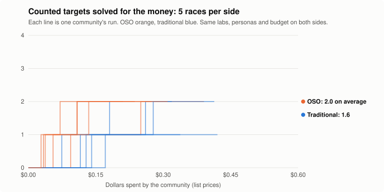

# Real agents, OSO vs traditional: race-cheap

**No clear difference: the OSO communities solved 2.0 of the counted targets and the traditional ones 1.6, on average over 5 runs each.**

The verdict compares the mean number of counted targets solved against two standard errors. The measure and the design were fixed before the runs.

| rules | counted targets solved | all targets | spent (mean) | conjectures proved | duplicated work | built on another lab's result |
| --- | --- | --- | --- | --- | --- | --- |
| Traditional | 1.6 ± 0.5 of 4 | 4.2 ± 0.8 of 8 | $0.34 | 6.0 ± 0.7 | 20.4 ± 15.3 | 0.0 ± 0.0 |
| OSO | 2.0 ± 0.0 of 4 | 5.2 ± 0.4 of 8 | $0.28 | 7.2 ± 0.8 | 2.4 ± 0.9 | 6.4 ± 0.5 |

Values are mean ± standard deviation over runs.

## The design, fixed in advance

Fixed before the runs (2026-10-20). Model: DeepSeek V4.1 Flash for every lab, so labs differ only by persona. Counted targets: the posted targets DeepSeek never proved alone in the pilot but did prove with their lemmas (A3, X2, B5, A5); X1 (not proved even with lemmas) and C3, C4, B3 (provable alone) are warm-ups. Posted conjectures: the counted targets' direct prerequisites in the reference tree, plus the whole chain under A5. Measure: counted targets solved for the same budget, mean over 5 runs per side, verdict against two standard errors.

- **Counted targets:** A3, X2, B5, A5. The others are warm-ups: solved, they are reported but do not count.
- **Labs:** lab 1: `deepseek/deepseek-v4.1-flash` as Foundation builder; lab 2: `deepseek/deepseek-v4.1-flash` as Foundation builder; lab 3: `deepseek/deepseek-v4.1-flash` as Target racer; lab 4: `deepseek/deepseek-v4.1-flash` as Neutral. The same labs and personas on both sides.
- **Budget:** $0.15 per lab at list prices; up to 30 rounds. **Posted conjectures:** 12, bounty 1 each; their ids (K1, …) are neutral, and their statements are given to the labs but not listed here.
- **Rules:** traditional: results private until their lab proves a target, then published with it; OSO: everything published at once, α = 0.8, c = 0.15, mint 1.

## Every run

| run | traditional: counted | spent | OSO: counted | spent | traditional duplicated | OSO duplicated | OSO built on others |
| --- | --- | --- | --- | --- | --- | --- | --- |
| 1 | 1 | $0.34 | 2 | $0.39 | 8 | 3 | 6 |
| 2 | 1 | $0.42 | 2 | $0.24 | 42 | 3 | 7 |
| 3 | 2 | $0.18 | 2 | $0.21 | 6 | 2 | 6 |
| 4 | 2 | $0.41 | 2 | $0.27 | 16 | 3 | 7 |
| 5 | 2 | $0.32 | 2 | $0.31 | 30 | 1 | 6 |

Transcripts, with every proof, are private.

## Exploratory (not fixed in advance)

These measures were looked at after the runs, so they are evidence to test next, not results.

| Spend to reach… | Traditional | OSO |
| --- | --- | --- |
| the 1st counted target | $0.13 on average (5 of 5 runs) | $0.05 (5 of 5) |
| the 2nd counted target | $0.24 on average, in 3 of 5 runs; never in the other 2 | $0.13, in 5 of 5 |

- **Which counted targets:** both sides solved only A3 and X2; neither solved B5 or A5 in any run. OSO solved both in every run; traditional solved both in 3 runs and one in 2.
- **Duplicated work:** traditional labs re-proved results another lab already held privately 20 times per run on average (6 to 42); OSO 2.4.
- **Building on each other:** OSO labs built on another lab's result about 6 times per run; traditional labs never could.
- **Lost actions:** 4 actions in the traditional communities failed on dropped connections (retried, then lost); none in OSO. That slightly disadvantages traditional.
- **Budgets were not binding:** both sides spent about half their $0.60, because labs passed when they saw nothing worth their budget. So the comparison is effectively what the same labs achieved, and at what cost, rather than who ran out of money first.
