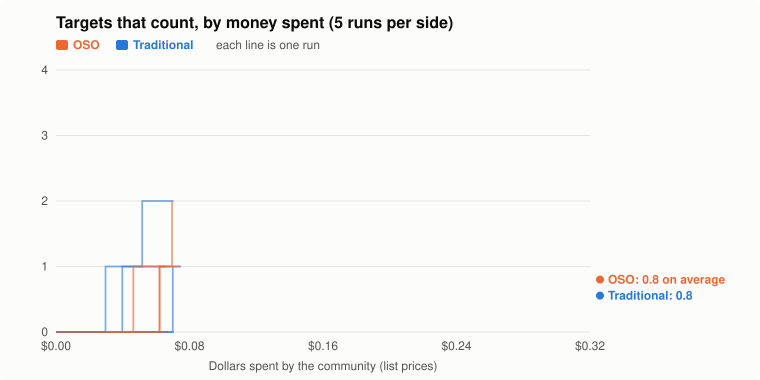

# Cheap AI models: who reaches the targets for less money

**Not valid:** The money on the key ran out during the test: 950 model calls were refused, so labs stopped early (only 24% of budgets used). Do not use this result.

**Question:** With the cheapest model, does an OSO community reach 2 of the targets that count for less money than a traditional one?

**Answer:** No clear difference: OSO solved 2 targets that count for $0.27 on average, traditional for $0.27 (1 and 1 of 5 runs got there).

| rules | money to 2 targets | targets that count | all targets | spent | ROI (value per $) | work done twice | used another lab's result |
| --- | --- | --- | --- | --- | --- | --- | --- |
| Traditional | $0.27 ± 0.12 | 0.8 ± 0.8 of 4 | 3.4 ± 1.1 of 8 | $0.07 | 1041.2 ± 537.9 | 3.6 ± 2.1 | 0.0 ± 0.0 |
| OSO | $0.27 ± 0.11 | 0.8 ± 0.8 of 4 | 2.4 ± 1.7 of 8 | $0.08 | 1011.0 ± 588.9 | 1.8 ± 0.8 | 2.4 ± 2.2 |

**Design** (fixed before the run): compared traditional rules and OSO rules · held the same: four DeepSeek V4.1 Flash labs (two foundation builders, a target racer, a neutral lab), $0.08 each, 12 posted conjectures, up to 30 rounds · measure: money spent to solve 2 of the targets that count (A3, X2, B5, A5); a run that never does counts as its whole budget, lower is better · 5 runs per side. Cost: $0.76 at list prices.

**Caveats:**
- Budgets were counted at list prices, but OpenRouter charged about 5.6× more ($3.56 against $0.69).
- Tests a lead first seen in the earlier cheap-model test, on fresh runs.
- One model and one small problem set.

Details

**Exploratory** (not fixed in advance): mean spend at which a run had k counted targets solved.

| counted targets | traditional | OSO |
| --- | --- | --- |
| 1 | $0.05 (3 of 5 runs) | $0.06 (3 of 5 runs) |
| 2 | $0.05 (1 of 5 runs) | $0.07 (1 of 5 runs) |

## The design, fixed in advance

Fixed before the runs (2026-10-21), to test what the earlier cheap-model test suggested: that OSO reached the targets for about half the money. Same labs, targets and helper results as that test; money per lab cut to $0.08 so the budget runs out. Main measure: money spent to solve 2 of the targets that count (A3, X2, B5, A5); a run that never gets there counts as its whole budget. Lower is better. Verdict against two standard errors, 5 runs per side.

- **Counted targets:** A3, X2, B5, A5. The others are warm-ups: solved, they are reported but do not count.
- **Labs:** lab 1: `deepseek/deepseek-v4.1-flash` as Foundation builder; lab 2: `deepseek/deepseek-v4.1-flash` as Foundation builder; lab 3: `deepseek/deepseek-v4.1-flash` as Target racer; lab 4: `deepseek/deepseek-v4.1-flash` as Neutral. The same labs and personas on both sides.
- **Budget:** $0.08 per lab at list prices; up to 30 rounds. **Posted conjectures:** 12, bounty 1 each; their ids (K1, …) are neutral, and their statements are given to the labs but not listed here.
- **Rules:** traditional: results private until their lab proves a target, then published with it; OSO: everything published at once, α = 0.8, c = 0.15, mint 1.

## Every run

| run | traditional: counted | spent | OSO: counted | spent | traditional duplicated | OSO duplicated | OSO built on others |
| --- | --- | --- | --- | --- | --- | --- | --- |
| 1 | 0 | $0.06 | 0 | $0.09 | 2 | 2 | 1 |
| 2 | 1 | $0.08 | 1 | $0.08 | 5 | 2 | 1 |
| 3 | 1 | $0.07 | 1 | $0.07 | 4 | 1 | 1 |
| 4 | 0 | $0.08 | 0 | $0.07 | 6 | 1 | 3 |
| 5 | 2 | $0.08 | 2 | $0.07 | 1 | 3 | 6 |

Transcripts, with every proof, are private.

