# Does the knowledge reward matter? Step by step, with and without

**Question:** Does paying a knowledge reward (1 per new bit, flowing back with α) change how far a society gets, and when?

**Answer:** With sharing set by the rules and equal money (step 1), the knowledge reward changes nothing. Once agents choose what to share and money follows earnings (steps 3-5), it matters at high α: at α = 0.8 a society solves 1.8 of 2 targets with it and 0.4 without (step 3). At α = 0.2 or 0 it barely matters: flowing value back already pays for intermediate work.

| step | society | with | without | difference |
| --- | --- | --- | --- | --- |
| 1 | α = 1 | 2.00 | 1.99 | +0.01 |
| 1 | α = 0.8 | 2.00 | 2.00 | +0.00 |
| 1 | α = 0.2 | 2.00 | 2.00 | +0.00 |
| 2 | α = 1 | 0.37 | 0.34 | +0.03 |
| 2 | α = 0.8 | 0.53 | 0.35 | +0.18 (clear) |
| 2 | α = 0.2 | 1.97 | 1.88 | +0.09 (clear) |
| 3 | α = 1 | 1.53 | 0.41 | +1.12 (clear) |
| 3 | α = 0.8 | 1.79 | 0.40 | +1.39 (clear) |
| 3 | α = 0.2 | 2.00 | 1.88 | +0.12 (clear) |
| 4 | α = 1 | 1.98 | 0.93 | +1.05 (clear) |
| 4 | α = 0.8 | 1.91 | 1.08 | +0.83 (clear) |
| 4 | α = 0.2 | 1.99 | 1.96 | +0.03 |
| 5 | α = 1 | 1.97 | 0.95 | +1.02 (clear) |
| 5 | α = 0.8 | 1.92 | 0.94 | +0.98 (clear) |
| 5 | α = 0.2 | 2.00 | 1.93 | +0.07 (clear) |

**Design** (fixed before the run): compared the knowledge reward on (1 per new bit) and off (0), at each step of the model and each α · held the same: everything else in each step experiment (6 × 8 generated graphs, 12 agents, budget 1,200); the same graphs and luck with and without · measure: targets solved (of 2), higher is better · 100 runs per point, paired.

**Caveats:**
- Exploratory, not fixed in advance: a first look with 40 runs per point came first (2026-11-06); this is the same comparison with more runs.
- "Clear" means the paired difference is more than two standard errors from zero.
- Step 1 has no α = 0 row; its open societies set β = 1, so sharing is fixed at 100%.

Details

## What the knowledge reward is

When an idea is published, each of its **new bits** (bits no published idea has yet) earns 1. The idea keeps α of that and the rest flows back to the ideas it built on, like a bounty. A copy or a trivial idea adds no new bits, so it earns nothing, and publishing first pays. It has been on in every model since v5; this result turns it off to see what it does.

## How it was run

Each of the five step-by-step experiments (each step adds one mechanism to the one before: [1. Sharing set by the rules, equal money](../simple-ideas-6x8-p2-len3g2-comp0-7-step1-alpha-beta-20261025/summary.md), [2. Agents choose what to share](../simple-ideas-6x8-p2-len3g2-comp0-7-step2-by-alpha-20261025/summary.md), [3. Half the money follows earnings](../simple-ideas-6x8-p2-len3g2-comp0-7-step3-by-alpha-20261025/summary.md), [4. Agents differ](../simple-ideas-6x8-p2-len3g2-comp0-7-step4-by-alpha-20261025/summary.md), [5. A gamer joins](../simple-ideas-6x8-p2-len3g2-comp0-7-step5-by-alpha-20261025/summary.md)) was rerun 100 times with the knowledge reward at 1 per new bit and again at 0, with the same graphs and the same luck, so each run with it has a twin without it.

## Every step and society

| step | society | targets solved, with | targets solved, without | difference | shared at once, with → without |
| --- | --- | --- | --- | --- | --- |
| 1. Sharing set by the rules, equal money | Traditional | 0.07 | 0.06 | +0.01 | 0% → 0% |
| 1. Sharing set by the rules, equal money | α = 1 | 2.00 | 1.99 | +0.01 | 100% → 100% |
| 1. Sharing set by the rules, equal money | α = 0.8 | 2.00 | 2.00 | +0.00 | 100% → 100% |
| 1. Sharing set by the rules, equal money | α = 0.2 | 2.00 | 2.00 | +0.00 | 100% → 100% |
| 2. Agents choose what to share | Traditional | 0.05 | 0.03 | +0.02 | 0% → 0% |
| 2. Agents choose what to share | α = 1 | 0.37 | 0.34 | +0.03 | 24% → 24% |
| 2. Agents choose what to share | α = 0.8 | 0.53 | 0.35 | +0.18 (clear) | 29% → 24% |
| 2. Agents choose what to share | α = 0.2 | 1.97 | 1.88 | +0.09 (clear) | 66% → 59% |
| 2. Agents choose what to share | α = 0 | 2.00 | 2.00 | +0.00 | 100% → 100% |
| 3. Half the money follows earnings | Traditional | 0.07 | 0.05 | +0.02 | 0% → 0% |
| 3. Half the money follows earnings | α = 1 | 1.53 | 0.41 | +1.12 (clear) | 26% → 24% |
| 3. Half the money follows earnings | α = 0.8 | 1.79 | 0.40 | +1.39 (clear) | 31% → 24% |
| 3. Half the money follows earnings | α = 0.2 | 2.00 | 1.88 | +0.12 (clear) | 66% → 58% |
| 3. Half the money follows earnings | α = 0 | 1.99 | 2.00 | -0.01 | 100% → 100% |
| 4. Agents differ | Traditional | 0.24 | 0.25 | -0.01 | 0% → 0% |
| 4. Agents differ | α = 1 | 1.98 | 0.93 | +1.05 (clear) | 32% → 28% |
| 4. Agents differ | α = 0.8 | 1.91 | 1.08 | +0.83 (clear) | 37% → 27% |
| 4. Agents differ | α = 0.2 | 1.99 | 1.96 | +0.03 | 66% → 53% |
| 4. Agents differ | α = 0 | 2.00 | 2.00 | +0.00 | 100% → 100% |
| 5. A gamer joins | Traditional | 0.31 | 0.30 | +0.01 | 0% → 0% |
| 5. A gamer joins | α = 1 | 1.97 | 0.95 | +1.02 (clear) | 33% → 26% |
| 5. A gamer joins | α = 0.8 | 1.92 | 0.94 | +0.98 (clear) | 36% → 27% |
| 5. A gamer joins | α = 0.2 | 2.00 | 1.93 | +0.07 (clear) | 66% → 51% |
| 5. A gamer joins | α = 0 | 1.99 | 1.99 | +0.00 | 100% → 100% |

## What it means

- **It only changes who is paid when nothing else depends on earnings** (step 1): the same ideas are found either way.
- **It matters when earnings steer what happens**, through agents choosing what to share (step 2, a little) or money following earnings (steps 3-5, a lot), and only at high α. Without it, an agent earns nothing until a target is proved, so money cannot move toward agents making progress.
- **Low α does the same job.** At α = 0.2 or 0 the flow-back already pays for intermediate work, so the knowledge reward adds little. It narrows the gap between α = 1 (sharing without flow-back) and OSO at α = 0.8.

Rerun: `npm run sim -- knowledge-reward`.

