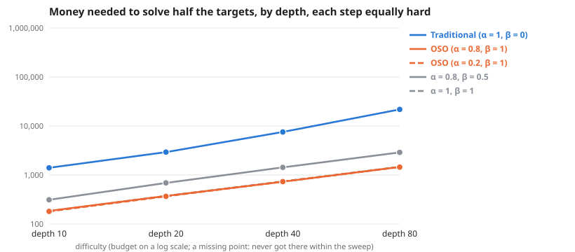

# Scaling across depth, each step equally hard

**Meta-analysis:** runs nothing itself; it combines the results of 4 experiments: [Deep graph: 10 levels, each step equally hard](../simple-ideas-10x4-p2-len3g2-new2-deep-scaling-20261025/summary.md), [Deep graph: 20 levels, each step equally hard](../simple-ideas-20x4-p2-len3g2-new2-deep-scaling-20261025/summary.md), [Deep graph: 40 levels, each step equally hard](../simple-ideas-40x4-p2-len3g2-new2-deep-scaling-20261025/summary.md), [Deep graph: 80 levels, each step equally hard](../simple-ideas-80x4-p2-len3g2-new2-deep-scaling-20261025/summary.md).

**Question:** Across depth, each step equally hard, how much money does each society need, and does the gap between traditional and OSO grow?

**Answer:** To solve half the targets, traditional needs 7.6× to 14.9× the money OSO needs. The gap grows with every step in difficulty.

| difficulty | Traditional (α = 1, β = 0) | OSO (α = 0.8, β = 1) | OSO (α = 0.2, β = 1) | α = 0.8, β = 0.5 | α = 1, β = 1 | traditional ÷ OSO |
| --- | --- | --- | --- | --- | --- | --- |
| depth 10 | 1,403 | 185 | 181 | 312 | 182 | 7.6× |
| depth 20 | 2,934 | 375 | 367 | 690 | 374 | 7.8× |
| depth 40 | 7,550 | 728 | 733 | 1,431 | 742 | 10.4× |
| depth 80 | 21,796 | 1,466 | 1,448 | 2,896 | 1,466 | 14.9× |

**Design** (fixed before the run): compared 5 societies on 4 difficulties (depth 10, depth 20, depth 40, depth 80) · held the same: the simple model: 12 identical agents, equal money each round, a knowledge reward of 1 per new bit, no validation · measure: money needed to solve half the targets, lower is better · from the sweeps tagged "deep graph 2026-10-25".

**Caveats:**
- Read off between the two budgets that bracket half the targets, in log budget.
- Each difficulty has its own budget range; "> x" means not reached within it.

Details

**Log–log slope of bounty value against budget** (where value is above 0 and below 90% of its most; a slope of 1 means value grows in proportion to money):

| difficulty | Traditional (α = 1, β = 0) | OSO (α = 0.8, β = 1) | OSO (α = 0.2, β = 1) | α = 0.8, β = 0.5 | α = 1, β = 1 |
| --- | --- | --- | --- | --- | --- |
| depth 10 | – | 3.38 | – | – | 2.32 |
| depth 20 | – | 4.73 | – | – | – |
| depth 40 | – | – | – | – | – |
| depth 80 | – | – | – | – | – |

