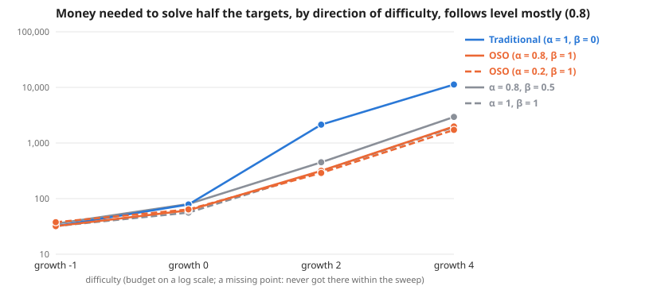

# Scaling across direction of difficulty, follows level mostly (0.8)

**Meta-analysis:** runs nothing itself; it combines the results of 4 experiments: [Direction of difficulty: easier by 1 bit per level; follows level mostly (0.8)](../simple-ideas-6x8-p2-len3gm1-comp0-7-tie0-8-direction-scaling-20261026/summary.md), [Direction of difficulty: every level equally hard; follows level mostly (0.8)](../simple-ideas-6x8-p2-len3g0-comp0-7-tie0-8-direction-scaling-20261026/summary.md), [Direction of difficulty: harder by 2 bits per level; follows level mostly (0.8)](../simple-ideas-6x8-p2-len3g2-comp0-7-tie0-8-direction-scaling-20261026/summary.md), [Direction of difficulty: harder by 4 bits per level; follows level mostly (0.8)](../simple-ideas-6x8-p2-len3g4-comp0-7-tie0-8-direction-scaling-20261026/summary.md).

**Question:** Across direction of difficulty, follows level mostly (0.8), how much money does each society need, and does the gap between traditional and OSO grow?

**Answer:** To solve half the targets, traditional needs 1.0× to 6.8× the money OSO needs. By difficulty: growth -1 1.0×, growth 0 1.3×, growth 2 6.8×, growth 4 5.7×.

| difficulty | Traditional (α = 1, β = 0) | OSO (α = 0.8, β = 1) | OSO (α = 0.2, β = 1) | α = 0.8, β = 0.5 | α = 1, β = 1 | traditional ÷ OSO |
| --- | --- | --- | --- | --- | --- | --- |
| growth -1 | 32 | 32 | 38 | 35 | 32 | 1.0× |
| growth 0 | 78 | 62 | 64 | 80 | 56 | 1.3× |
| growth 2 | 2,139 | 316 | 289 | 450 | 312 | 6.8× |
| growth 4 | 11,255 | 1,982 | 1,722 | 2,945 | 1,923 | 5.7× |

**Design** (fixed before the run): compared 5 societies on 4 difficulties (growth -1, growth 0, growth 2, growth 4) · held the same: the simple model: 12 identical agents, equal money each round, a knowledge reward of 1 per new bit, no validation · measure: money needed to solve half the targets, lower is better · from the sweeps tagged "direction 2026-10-26: follows 0.8".

**Caveats:**
- Read off between the two budgets that bracket half the targets, in log budget.
- Each difficulty has its own budget range; "> x" means not reached within it.

Details

**Log–log slope of bounty value against budget** (where value is above 0 and below 90% of its most; a slope of 1 means value grows in proportion to money):

| difficulty | Traditional (α = 1, β = 0) | OSO (α = 0.8, β = 1) | OSO (α = 0.2, β = 1) | α = 0.8, β = 0.5 | α = 1, β = 1 |
| --- | --- | --- | --- | --- | --- |
| growth -1 | 0.77 | 0.56 | 0.73 | 0.83 | 0.56 |
| growth 0 | 1.11 | 1.25 | 1.91 | 1.12 | 1.96 |
| growth 2 | 0.41 | 0.80 | 1.00 | 0.78 | 0.85 |
| growth 4 | 0.28 | 0.51 | 0.84 | 0.50 | 0.52 |

