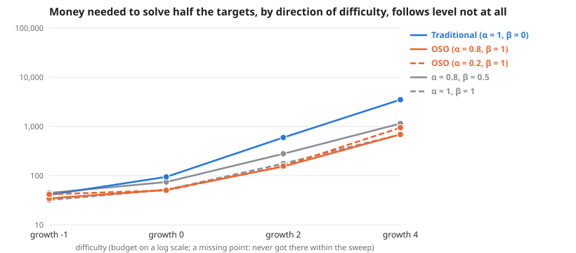

# Scaling across direction of difficulty, follows level not at all

**Meta-analysis:** runs nothing itself; it combines the results of 4 experiments: [Direction of difficulty: easier by 1 bit per level; follows level not at all](../simple-ideas-6x8-p2-len3gm1-comp0-7-tie0-direction-scaling-20261026/summary.md), [Direction of difficulty: every level equally hard; follows level not at all](../simple-ideas-6x8-p2-len3g0-comp0-7-tie0-direction-scaling-20261026/summary.md), [Direction of difficulty: harder by 2 bits per level; follows level not at all](../simple-ideas-6x8-p2-len3g2-comp0-7-tie0-direction-scaling-20261026/summary.md), [Direction of difficulty: harder by 4 bits per level; follows level not at all](../simple-ideas-6x8-p2-len3g4-comp0-7-tie0-direction-scaling-20261026/summary.md).

**Question:** Across direction of difficulty, follows level not at all, how much money does each society need, and does the gap between traditional and OSO grow?

**Answer:** To solve half the targets, traditional needs 1.2× to 5.1× the money OSO needs. The gap grows with every step in difficulty.

| difficulty | Traditional (α = 1, β = 0) | OSO (α = 0.8, β = 1) | OSO (α = 0.2, β = 1) | α = 0.8, β = 0.5 | α = 1, β = 1 | traditional ÷ OSO |
| --- | --- | --- | --- | --- | --- | --- |
| growth -1 | 41 | 35 | 42 | 45 | 32 | 1.2× |
| growth 0 | 95 | 52 | 50 | 74 | 52 | 1.8× |
| growth 2 | 597 | 154 | 157 | 279 | 176 | 3.9× |
| growth 4 | 3,511 | 689 | 948 | 1,149 | 689 | 5.1× |

**Design** (fixed before the run): compared 5 societies on 4 difficulties (growth -1, growth 0, growth 2, growth 4) · held the same: the simple model: 12 identical agents, equal money each round, a knowledge reward of 1 per new bit, no validation · measure: money needed to solve half the targets, lower is better · from the sweeps tagged "direction 2026-10-26: follows 0".

**Caveats:**
- Read off between the two budgets that bracket half the targets, in log budget.
- Each difficulty has its own budget range; "> x" means not reached within it.

Details

**Log–log slope of bounty value against budget** (where value is above 0 and below 90% of its most; a slope of 1 means value grows in proportion to money):

| difficulty | Traditional (α = 1, β = 0) | OSO (α = 0.8, β = 1) | OSO (α = 0.2, β = 1) | α = 0.8, β = 0.5 | α = 1, β = 1 |
| --- | --- | --- | --- | --- | --- |
| growth -1 | 0.51 | – | 1.20 | 1.49 | – |
| growth 0 | 0.85 | 1.66 | 2.58 | 1.13 | 1.96 |
| growth 2 | 0.54 | 0.91 | 1.47 | 0.65 | 0.71 |
| growth 4 | 0.28 | 0.35 | 0.58 | 0.34 | 0.38 |

