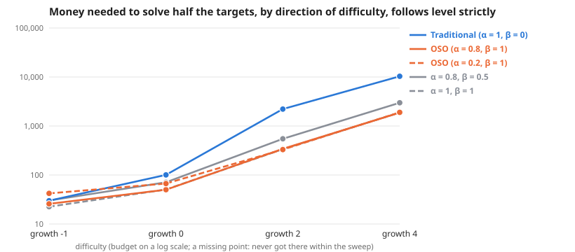

# Scaling across direction of difficulty, follows level strictly

**Meta-analysis:** runs nothing itself; it combines the results of 4 experiments: [Direction of difficulty: easier by 1 bit per level; follows level strictly](../simple-ideas-6x8-p2-len3gm1-comp0-7-tie1-direction-scaling-20261026/summary.md), [Direction of difficulty: every level equally hard; follows level strictly](../simple-ideas-6x8-p2-len3g0-comp0-7-tie1-direction-scaling-20261026/summary.md), [Direction of difficulty: harder by 2 bits per level; follows level strictly](../simple-ideas-6x8-p2-len3g2-comp0-7-tie1-direction-scaling-20261026/summary.md), [Direction of difficulty: harder by 4 bits per level; follows level strictly](../simple-ideas-6x8-p2-len3g4-comp0-7-tie1-direction-scaling-20261026/summary.md).

**Question:** Across direction of difficulty, follows level strictly, how much money does each society need, and does the gap between traditional and OSO grow?

**Answer:** To solve half the targets, traditional needs 1.2× to 6.5× the money OSO needs. By difficulty: growth -1 1.2×, growth 0 2.0×, growth 2 6.5×, growth 4 5.5×.

| difficulty | Traditional (α = 1, β = 0) | OSO (α = 0.8, β = 1) | OSO (α = 0.2, β = 1) | α = 0.8, β = 0.5 | α = 1, β = 1 | traditional ÷ OSO |
| --- | --- | --- | --- | --- | --- | --- |
| growth -1 | 30 | 26 | 42 | 30 | 23 | 1.2× |
| growth 0 | 101 | 50 | 67 | 71 | 51 | 2.0× |
| growth 2 | 2,214 | 342 | 330 | 549 | 336 | 6.5× |
| growth 4 | 10,350 | 1,872 | 1,898 | 2,983 | 1,879 | 5.5× |

**Design** (fixed before the run): compared 5 societies on 4 difficulties (growth -1, growth 0, growth 2, growth 4) · held the same: the simple model: 12 identical agents, equal money each round, a knowledge reward of 1 per new bit, no validation · measure: money needed to solve half the targets, lower is better · from the sweeps tagged "direction 2026-10-26: follows 1".

**Caveats:**
- Read off between the two budgets that bracket half the targets, in log budget.
- Each difficulty has its own budget range; "> x" means not reached within it.

Details

**Log–log slope of bounty value against budget** (where value is above 0 and below 90% of its most; a slope of 1 means value grows in proportion to money):

| difficulty | Traditional (α = 1, β = 0) | OSO (α = 0.8, β = 1) | OSO (α = 0.2, β = 1) | α = 0.8, β = 0.5 | α = 1, β = 1 |
| --- | --- | --- | --- | --- | --- |
| growth -1 | 0.69 | 0.70 | 0.87 | 0.75 | 0.90 |
| growth 0 | 0.84 | 1.35 | 1.62 | 1.08 | 1.31 |
| growth 2 | 7.03 | 2.74 | 3.66 | 2.45 | 3.24 |
| growth 4 | 3.52 | 1.98 | 2.15 | 2.61 | 2.17 |

