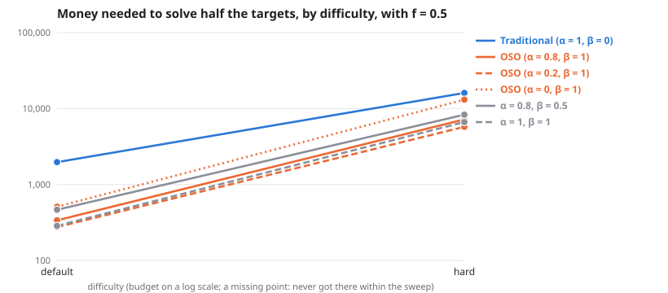

# Scaling across difficulty, with f = 0.5

**Question:** As difficulty, with f = 0.5 changes (everything else as the default graph), how much money does each society need, and does the gap between traditional and OSO grow?

**Answer:** To solve half the targets, traditional needs 2.2× to 5.8× the money OSO needs. By difficulty: default 5.8×, hard 2.2×.

| difficulty | Traditional (α = 1, β = 0) | OSO (α = 0.8, β = 1) | OSO (α = 0.2, β = 1) | OSO (α = 0, β = 1) | α = 0.8, β = 0.5 | α = 1, β = 1 | traditional ÷ OSO |
| --- | --- | --- | --- | --- | --- | --- | --- |
| default | 1,969 | 338 | 275 | 510 | 466 | 285 | 5.8× |
| hard | 16,032 | 7,193 | 5,746 | 13,075 | 8,303 | 6,637 | 2.2× |

**Design** (fixed before the run): compared 6 societies on 2 difficulties (default, hard) · held the same: the simple model: 12 identical agents, equal money each round, no mint, no validation · measure: money needed to solve half the targets, lower is better · from the sweeps tagged "f 0.5".

**Caveats:**
- Read off between the two budgets that bracket half the targets, in log budget.
- Each difficulty has its own budget range; "> x" means not reached within it.

Details

**Log–log slope of bounty value against budget** (where value is above 0 and below 90% of its most; a slope of 1 means value grows in proportion to money):

| difficulty | Traditional (α = 1, β = 0) | OSO (α = 0.8, β = 1) | OSO (α = 0.2, β = 1) | OSO (α = 0, β = 1) | α = 0.8, β = 0.5 | α = 1, β = 1 |
| --- | --- | --- | --- | --- | --- | --- |
| default | – | 3.58 | 4.09 | 3.25 | 3.49 | 2.68 |
| hard | 3.65 | 1.72 | 1.60 | 1.77 | 1.88 | 1.75 |

From: [Scaling with earnings shaping next round's money (f = 0.5): Default graph (6 × 8)](../simple-ideas-6x8-p2-len3g2-comp0-7-f0-5-scaling-20261024/summary.md), [Scaling with earnings shaping next round's money (f = 0.5): Hard graph (10 × 10)](../simple-ideas-10x10-p2-5-len4g3-comp0-7-bounties-from-5-f0-5-scaling-20261024/summary.md).

