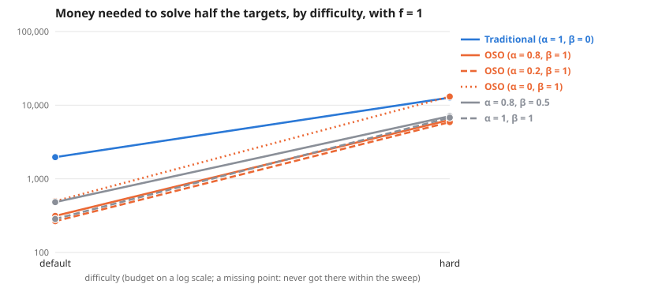

# Scaling across difficulty, with f = 1

**Meta-analysis:** runs nothing itself; it combines the results of 2 experiments: [Scaling with earnings shaping next round's money (f = 1): Default graph (6 × 8)](../simple-ideas-6x8-p2-len3g2-comp0-7-f1-scaling-20261024/summary.md), [Scaling with earnings shaping next round's money (f = 1): Hard graph (10 × 10)](../simple-ideas-10x10-p2-5-len4g3-comp0-7-bounties-from-5-f1-scaling-20261024/summary.md).

**Question:** Across difficulty, with f = 1, how much money does each society need, and does the gap between traditional and OSO grow?

**Answer:** To solve half the targets, traditional needs 1.7× to 4.9× the money OSO needs. By difficulty: default 4.9×, hard 1.7×.

| difficulty | Traditional (α = 1, β = 0) | OSO (α = 0.8, β = 1) | OSO (α = 0.2, β = 1) | OSO (α = 0, β = 1) | α = 0.8, β = 0.5 | α = 1, β = 1 | traditional ÷ OSO |
| --- | --- | --- | --- | --- | --- | --- | --- |
| default | 1,783 | 366 | 307 | 556 | 352 | 308 | 4.9× |
| hard | 12,054 | 6,922 | 6,078 | 14,082 | 6,563 | 6,404 | 1.7× |

**Design** (fixed before the run): compared 6 societies on 2 difficulties (default, hard) · held the same: the simple model: 12 identical agents, equal money each round, a knowledge reward of 1 per new bit, no validation · measure: money needed to solve half the targets, lower is better · from the sweeps tagged "f 1".

**Caveats:**
- Read off between the two budgets that bracket half the targets, in log budget.
- Each difficulty has its own budget range; "> x" means not reached within it.

Details

**Log–log slope of bounty value against budget** (where value is above 0 and below 90% of its most; a slope of 1 means value grows in proportion to money):

| difficulty | Traditional (α = 1, β = 0) | OSO (α = 0.8, β = 1) | OSO (α = 0.2, β = 1) | OSO (α = 0, β = 1) | α = 0.8, β = 0.5 | α = 1, β = 1 |
| --- | --- | --- | --- | --- | --- | --- |
| default | 4.67 | 4.32 | 3.86 | 2.46 | 4.39 | 4.86 |
| hard | 3.12 | 1.88 | 1.55 | 1.89 | 1.82 | 1.76 |

