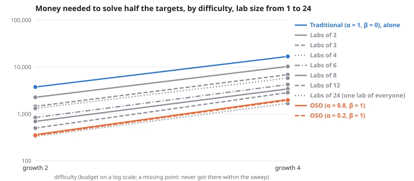

# Scaling across difficulty, lab size from 1 to 24

**Meta-analysis:** runs nothing itself; it combines the results of 2 experiments: [Lab size, from everyone alone to one lab of everyone, on the default graph (deeper ideas harder by 2 bits per level)](../simple-ideas-6x8-p2-len3g2-comp0-7-lab-size-24-agents-scaling-20261028/summary.md), [Lab size, from everyone alone to one lab of everyone, on a graph where deeper ideas are much harder (4 bits per level)](../simple-ideas-6x8-p2-len3g4-comp0-7-lab-size-24-agents-scaling-20261028/summary.md).

**Question:** Across difficulty, lab size from 1 to 24, how much money does each society need, and does the gap between traditional and OSO grow?

**Answer:** To solve half the targets, traditional needs 8.3× to 10.4× the money OSO needs. By difficulty: growth 2 10.4×, growth 4 8.3×.

| difficulty | Traditional (α = 1, β = 0), alone | Labs of 2 | Labs of 3 | Labs of 4 | Labs of 6 | Labs of 8 | Labs of 12 | Labs of 24 (one lab of everyone) | OSO (α = 0.8, β = 1) | OSO (α = 0.2, β = 1) | traditional ÷ OSO |
| --- | --- | --- | --- | --- | --- | --- | --- | --- | --- | --- | --- |
| growth 2 | 3,754 | 2,269 | 1,454 | 1,315 | 840 | 696 | 500 | 334 | 363 | 350 | 10.4× |
| growth 4 | 16,820 | 10,277 | 6,875 | 5,816 | 4,246 | 3,425 | 2,854 | 1,681 | 2,036 | 1,966 | 8.3× |

**Design** (fixed before the run): compared 10 societies on 2 difficulties (growth 2, growth 4) · held the same: the simple model: 12 identical agents, equal money each round, a knowledge reward of 1 per new bit, no validation · measure: money needed to solve half the targets, lower is better · from the sweeps tagged "lab size 2026-10-28".

**Caveats:**
- Read off between the two budgets that bracket half the targets, in log budget.
- Each difficulty has its own budget range; "> x" means not reached within it.

Details

**Log–log slope of bounty value against budget** (where value is above 0 and below 90% of its most; a slope of 1 means value grows in proportion to money):

| difficulty | Traditional (α = 1, β = 0), alone | Labs of 2 | Labs of 3 | Labs of 4 | Labs of 6 | Labs of 8 | Labs of 12 | Labs of 24 (one lab of everyone) | OSO (α = 0.8, β = 1) | OSO (α = 0.2, β = 1) |
| --- | --- | --- | --- | --- | --- | --- | --- | --- | --- | --- |
| growth 2 | 3.95 | 3.48 | 4.58 | 3.04 | 3.84 | – | 4.95 | 4.50 | 3.49 | 2.24 |
| growth 4 | 6.18 | 3.22 | 3.07 | 3.44 | 2.61 | 2.99 | 3.40 | 3.28 | 2.10 | 2.14 |

