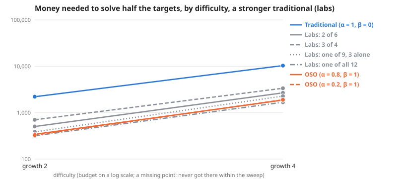

# Scaling across difficulty, a stronger traditional (labs)

**Meta-analysis:** runs nothing itself; it combines the results of 2 experiments: [A stronger traditional: labs that share inside, on the default graph (deeper ideas harder by 2 bits per level)](../simple-ideas-6x8-p2-len3g2-comp0-7-labs-scaling-20261028/summary.md), [A stronger traditional: labs that share inside, on a graph where deeper ideas are much harder (4 bits per level)](../simple-ideas-6x8-p2-len3g4-comp0-7-labs-scaling-20261028/summary.md).

**Question:** Across difficulty, a stronger traditional (labs), how much money does each society need, and does the gap between traditional and OSO grow?

**Answer:** To solve half the targets, traditional needs 5.5× to 6.5× the money OSO needs. By difficulty: growth 2 6.5×, growth 4 5.5×.

| difficulty | Traditional (α = 1, β = 0) | Labs: 2 of 6 | Labs: 3 of 4 | Labs: one of 9, 3 alone | Labs: one of all 12 | OSO (α = 0.8, β = 1) | OSO (α = 0.2, β = 1) | traditional ÷ OSO |
| --- | --- | --- | --- | --- | --- | --- | --- | --- |
| growth 2 | 2,214 | 505 | 704 | 386 | 318 | 342 | 330 | 6.5× |
| growth 4 | 10,350 | 2,679 | 3,362 | 2,276 | 1,680 | 1,872 | 1,898 | 5.5× |

**Design** (fixed before the run): compared 7 societies on 2 difficulties (growth 2, growth 4) · held the same: the simple model: 12 identical agents, equal money each round, a knowledge reward of 1 per new bit, no validation · measure: money needed to solve half the targets, lower is better · from the sweeps tagged "labs 2026-10-28".

**Caveats:**
- Read off between the two budgets that bracket half the targets, in log budget.
- Each difficulty has its own budget range; "> x" means not reached within it.

Details

**Log–log slope of bounty value against budget** (where value is above 0 and below 90% of its most; a slope of 1 means value grows in proportion to money):

| difficulty | Traditional (α = 1, β = 0) | Labs: 2 of 6 | Labs: 3 of 4 | Labs: one of 9, 3 alone | Labs: one of all 12 | OSO (α = 0.8, β = 1) | OSO (α = 0.2, β = 1) |
| --- | --- | --- | --- | --- | --- | --- | --- |
| growth 2 | 7.03 | 4.45 | 2.60 | 3.12 | – | 2.74 | 3.66 |
| growth 4 | 3.52 | 2.72 | 2.40 | 1.75 | 3.28 | 1.98 | 2.15 |

