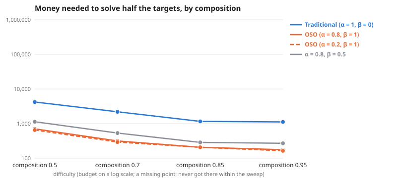

# Scaling as composition changes

**Question:** As composition changes (everything else as the default graph), how much money does each society need, and does the gap between traditional and OSO grow?

**Answer:** To solve half the targets, traditional needs 5.6× to 7.0× the money OSO needs. By difficulty: composition 0.5 6.0×, composition 0.7 7.0×, composition 0.85 5.6×, composition 0.95 6.3×.

| difficulty | Traditional (α = 1, β = 0) | OSO (α = 0.8, β = 1) | OSO (α = 0.2, β = 1) | α = 0.8, β = 0.5 | traditional ÷ OSO |
| --- | --- | --- | --- | --- | --- |
| composition 0.5 | 4,205 | 705 | 654 | 1,131 | 6.0× |
| composition 0.7 | 2,193 | 315 | 293 | 533 | 7.0× |
| composition 0.85 | 1,158 | 207 | 207 | 286 | 5.6× |
| composition 0.95 | 1,120 | 176 | 164 | 270 | 6.3× |

**Design** (fixed before the run): compared 4 societies on 4 difficulties (composition 0.5, composition 0.7, composition 0.85, composition 0.95) · held the same: the simple model: 12 identical agents, equal money each round, a knowledge reward of 1 per new bit, no validation · measure: money needed to solve half the targets, lower is better · from the sweeps tagged "one at a time 2026-10-24: composition".

**Caveats:**
- Read off between the two budgets that bracket half the targets, in log budget.
- Each difficulty has its own budget range; "> x" means not reached within it.

Details

**Log–log slope of bounty value against budget** (where value is above 0 and below 90% of its most; a slope of 1 means value grows in proportion to money):

| difficulty | Traditional (α = 1, β = 0) | OSO (α = 0.8, β = 1) | OSO (α = 0.2, β = 1) | α = 0.8, β = 0.5 |
| --- | --- | --- | --- | --- |
| composition 0.5 | – | 3.58 | 3.17 | 2.50 |
| composition 0.7 | – | 3.27 | 3.04 | 3.00 |
| composition 0.85 | 3.09 | 4.25 | 4.25 | 2.46 |
| composition 0.95 | – | 3.58 | 2.35 | – |

From: [Scaling, composition 0.5 (else default)](../simple-ideas-6x8-p2-len3g2-comp0-5-one-at-a-time-composition-20261024/summary.md), [Scaling, composition 0.7 (else default)](../simple-ideas-6x8-p2-len3g2-comp0-7-one-at-a-time-composition-20261024/summary.md), [Scaling, composition 0.85 (else default)](../simple-ideas-6x8-p2-len3g2-comp0-85-one-at-a-time-composition-20261024/summary.md), [Scaling, composition 0.95 (else default)](../simple-ideas-6x8-p2-len3g2-comp0-95-one-at-a-time-composition-20261024/summary.md).

