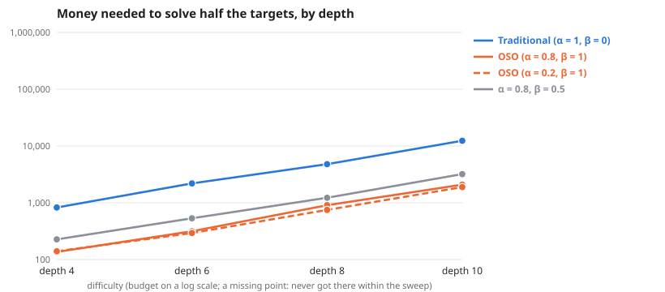

# Scaling as depth changes

**Question:** As depth changes (everything else as the default graph), how much money does each society need, and does the gap between traditional and OSO grow?

**Answer:** To solve half the targets, traditional needs 4.9× to 6.4× the money OSO needs. By difficulty: depth 4 4.9×, depth 6 6.3×, depth 8 6.4×, depth 10 6.2×.

| difficulty | Traditional (α = 1, β = 0) | OSO (α = 0.8, β = 1) | OSO (α = 0.2, β = 1) | α = 0.8, β = 0.5 | traditional ÷ OSO |
| --- | --- | --- | --- | --- | --- |
| depth 4 | 592 | 122 | 122 | 192 | 4.9× |
| depth 6 | 2,046 | 323 | 292 | 538 | 6.3× |
| depth 8 | 4,786 | 749 | 744 | 1,270 | 6.4× |
| depth 10 | 13,673 | 2,198 | 2,049 | 3,456 | 6.2× |

**Design** (fixed before the run): compared 4 societies on 4 difficulties (depth 4, depth 6, depth 8, depth 10) · held the same: the simple model: 12 identical agents, equal money each round, no mint, no validation · measure: money needed to solve half the targets, lower is better · from the sweeps tagged "one at a time 2026-10-24: depth".

**Caveats:**
- Read off between the two budgets that bracket half the targets, in log budget.
- Each difficulty has its own budget range; "> x" means not reached within it.

Details

**Log–log slope of bounty value against budget** (where value is above 0 and below 90% of its most; a slope of 1 means value grows in proportion to money):

| difficulty | Traditional (α = 1, β = 0) | OSO (α = 0.8, β = 1) | OSO (α = 0.2, β = 1) | α = 0.8, β = 0.5 |
| --- | --- | --- | --- | --- |
| depth 4 | 3.46 | 1.32 | 3.70 | 1.70 |
| depth 6 | – | 3.81 | 3.50 | – |
| depth 8 | 4.04 | 4.46 | 2.87 | 2.81 |
| depth 10 | 2.08 | 2.52 | 1.64 | – |

From: [Scaling, depth 4 (else default)](../simple-ideas-4x8-p2-len3g2-comp0-7-one-at-a-time-depth-20261024/summary.md), [Scaling, depth 6 (else default)](../simple-ideas-6x8-p2-len3g2-comp0-7-one-at-a-time-depth-20261024/summary.md), [Scaling, depth 8 (else default)](../simple-ideas-8x8-p2-len3g2-comp0-7-one-at-a-time-depth-20261024/summary.md), [Scaling, depth 10 (else default)](../simple-ideas-10x8-p2-len3g2-comp0-7-one-at-a-time-depth-20261024/summary.md).

