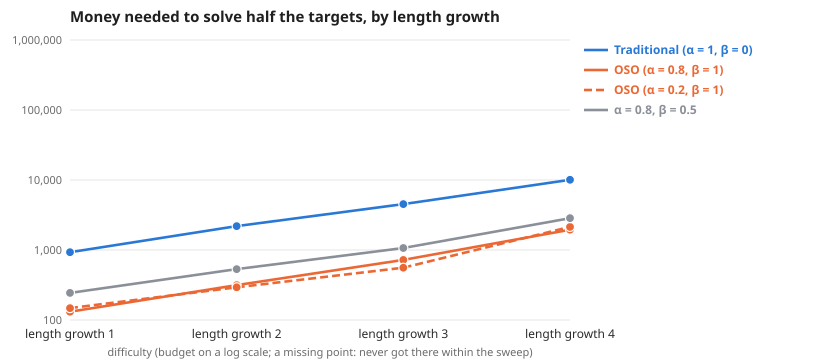

# Scaling as length growth changes

**Question:** As length growth changes (everything else as the default graph), how much money does each society need, and does the gap between traditional and OSO grow?

**Answer:** To solve half the targets, traditional needs 5.2× to 7.1× the money OSO needs. By difficulty: length growth 1 7.1×, length growth 2 7.0×, length growth 3 6.3×, length growth 4 5.2×.

| difficulty | Traditional (α = 1, β = 0) | OSO (α = 0.8, β = 1) | OSO (α = 0.2, β = 1) | α = 0.8, β = 0.5 | traditional ÷ OSO |
| --- | --- | --- | --- | --- | --- |
| length growth 1 | 930 | 131 | 148 | 244 | 7.1× |
| length growth 2 | 2,193 | 315 | 293 | 533 | 7.0× |
| length growth 3 | 4,525 | 721 | 558 | 1,068 | 6.3× |
| length growth 4 | 10,069 | 1,950 | 2,136 | 2,851 | 5.2× |

**Design** (fixed before the run): compared 4 societies on 4 difficulties (length growth 1, length growth 2, length growth 3, length growth 4) · held the same: the simple model: 12 identical agents, equal money each round, no mint, no validation · measure: money needed to solve half the targets, lower is better · from the sweeps tagged "one at a time 2026-10-24: length growth".

**Caveats:**
- Read off between the two budgets that bracket half the targets, in log budget.
- Each difficulty has its own budget range; "> x" means not reached within it.

Details

**Log–log slope of bounty value against budget** (where value is above 0 and below 90% of its most; a slope of 1 means value grows in proportion to money):

| difficulty | Traditional (α = 1, β = 0) | OSO (α = 0.8, β = 1) | OSO (α = 0.2, β = 1) | α = 0.8, β = 0.5 |
| --- | --- | --- | --- | --- |
| length growth 1 | 0.88 | 3.17 | 4.09 | 1.79 |
| length growth 2 | – | 3.27 | 3.04 | 3.00 |
| length growth 3 | 1.78 | 2.94 | 2.54 | 1.77 |
| length growth 4 | 2.43 | 1.16 | 1.88 | 2.20 |

From: [Scaling, length growth 1 (else default)](../simple-ideas-6x8-p2-len3g1-comp0-7-one-at-a-time-length-growth-20261024/summary.md), [Scaling, length growth 2 (else default)](../simple-ideas-6x8-p2-len3g2-comp0-7-one-at-a-time-length-growth-20261024/summary.md), [Scaling, length growth 3 (else default)](../simple-ideas-6x8-p2-len3g3-comp0-7-one-at-a-time-length-growth-20261024/summary.md), [Scaling, length growth 4 (else default)](../simple-ideas-6x8-p2-len3g4-comp0-7-one-at-a-time-length-growth-20261024/summary.md).

