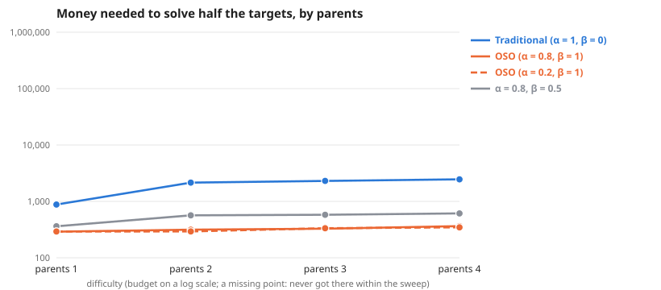

# Scaling as parents changes

**Question:** As parents changes (everything else as the default graph), how much money does each society need, and does the gap between traditional and OSO grow?

**Answer:** To solve half the targets, traditional needs 4.4× to 6.9× the money OSO needs. By difficulty: parents 1 4.4×, parents 2 6.3×, parents 3 6.9×, parents 4 6.5×.

| difficulty | Traditional (α = 1, β = 0) | OSO (α = 0.8, β = 1) | OSO (α = 0.2, β = 1) | α = 0.8, β = 0.5 | traditional ÷ OSO |
| --- | --- | --- | --- | --- | --- |
| parents 1 | 1,029 | 235 | 260 | 400 | 4.4× |
| parents 2 | 2,046 | 323 | 292 | 538 | 6.3× |
| parents 3 | 2,288 | 332 | 308 | 579 | 6.9× |
| parents 4 | 2,363 | 362 | 303 | 592 | 6.5× |

**Design** (fixed before the run): compared 4 societies on 4 difficulties (parents 1, parents 2, parents 3, parents 4) · held the same: the simple model: 12 identical agents, equal money each round, no mint, no validation · measure: money needed to solve half the targets, lower is better · from the sweeps tagged "one at a time 2026-10-24: parents".

**Caveats:**
- Read off between the two budgets that bracket half the targets, in log budget.
- Each difficulty has its own budget range; "> x" means not reached within it.

Details

**Log–log slope of bounty value against budget** (where value is above 0 and below 90% of its most; a slope of 1 means value grows in proportion to money):

| difficulty | Traditional (α = 1, β = 0) | OSO (α = 0.8, β = 1) | OSO (α = 0.2, β = 1) | α = 0.8, β = 0.5 |
| --- | --- | --- | --- | --- |
| parents 1 | 1.50 | 2.02 | 2.52 | 0.79 |
| parents 2 | – | 3.81 | 3.50 | – |
| parents 3 | 3.13 | 4.75 | 3.95 | 3.09 |
| parents 4 | 4.09 | 3.52 | 2.58 | 3.46 |

From: [Scaling, parents 1 (else default)](../simple-ideas-6x8-p1-len3g2-comp0-7-one-at-a-time-parents-20261024/summary.md), [Scaling, parents 2 (else default)](../simple-ideas-6x8-p2-len3g2-comp0-7-one-at-a-time-parents-20261024/summary.md), [Scaling, parents 3 (else default)](../simple-ideas-6x8-p3-len3g2-comp0-7-one-at-a-time-parents-20261024/summary.md), [Scaling, parents 4 (else default)](../simple-ideas-6x8-p4-len3g2-comp0-7-one-at-a-time-parents-20261024/summary.md).

