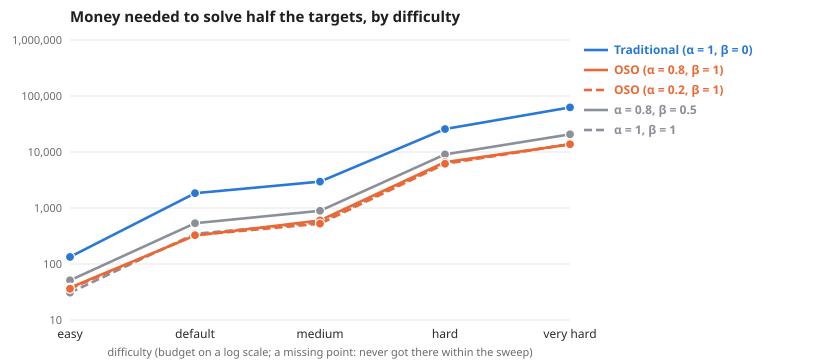

# Scaling across difficulty

**Question:** As problems get harder, how much more money does each society need, and does the gap between traditional and OSO grow?

**Answer:** To solve half the targets, traditional needs 3.6× to 6.5× the money OSO needs. By difficulty: easy 3.6×, default 6.5×, medium 4.8×, hard 4.1×, very hard 4.6×.

| difficulty | Traditional (α = 1, β = 0) | OSO (α = 0.8, β = 1) | OSO (α = 0.2, β = 1) | α = 0.8, β = 0.5 | α = 1, β = 1 | traditional ÷ OSO |
| --- | --- | --- | --- | --- | --- | --- |
| easy | 135 | 38 | 36 | 51 | 31 | 3.6× |
| default | 2,081 | 322 | 327 | 518 | 346 | 6.5× |
| medium | 2,857 | 600 | 525 | 885 | 553 | 4.8× |
| hard | 27,357 | 6,602 | 6,167 | 9,898 | 6,365 | 4.1× |
| very hard | 63,351 | 13,676 | 13,770 | 20,000 | 13,857 | 4.6× |

**Design** (fixed before the run): compared 5 societies on 5 difficulties (easy, default, medium, hard, very hard) · held the same: the simple model: 12 identical agents, equal money each round, no mint, no validation · measure: money needed to solve half the targets, lower is better · from the sweeps tagged "scaling ladder 2026-10-24".

**Caveats:**
- Read off between the two budgets that bracket half the targets, in log budget.
- Each difficulty has its own budget range; "> x" means not reached within it.

Details

**Log–log slope of bounty value against budget** (where value is above 0 and below 90% of its most; a slope of 1 means value grows in proportion to money):

| difficulty | Traditional (α = 1, β = 0) | OSO (α = 0.8, β = 1) | OSO (α = 0.2, β = 1) | α = 0.8, β = 0.5 | α = 1, β = 1 |
| --- | --- | --- | --- | --- | --- |
| easy | 1.87 | 1.42 | 1.94 | 2.05 | 0.87 |
| default | 3.62 | – | 3.70 | 3.21 | 4.52 |
| medium | 2.58 | 2.69 | 2.48 | 2.40 | 3.55 |
| hard | 2.59 | 1.72 | 1.54 | 1.74 | 1.80 |
| very hard | 2.52 | 1.75 | 1.71 | 2.03 | 1.84 |

From: [Scaling: Easy graph (4 × 6)](../simple-ideas-4x6-p1-5-len2g1-comp0-7-scaling-ladder-20261024/summary.md), [Scaling: Default graph (6 × 8)](../simple-ideas-6x8-p2-len3g2-comp0-7-scaling-ladder-20261024/summary.md), [Scaling: Medium graph (8 × 8, bounties from level 5)](../simple-ideas-8x8-p2-len3g2-comp0-7-bounties-from-5-scaling-ladder-20261024/summary.md), [Scaling: Hard graph (10 × 10)](../simple-ideas-10x10-p2-5-len4g3-comp0-7-bounties-from-5-scaling-ladder-20261024/summary.md), [Scaling: Very hard graph (14 × 12)](../simple-ideas-14x12-p3-len4g3-comp0-8-bounties-from-7-scaling-ladder-20261024/summary.md).

